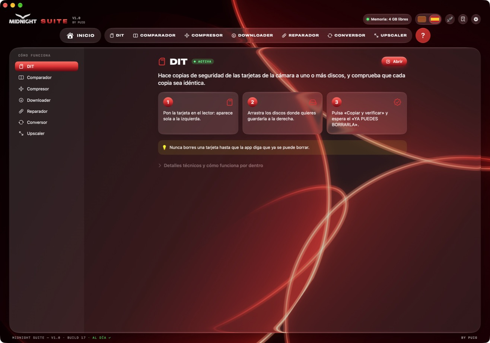
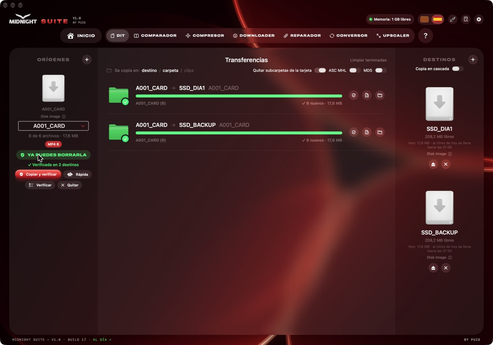
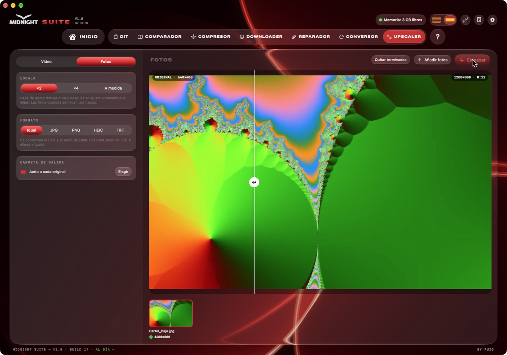
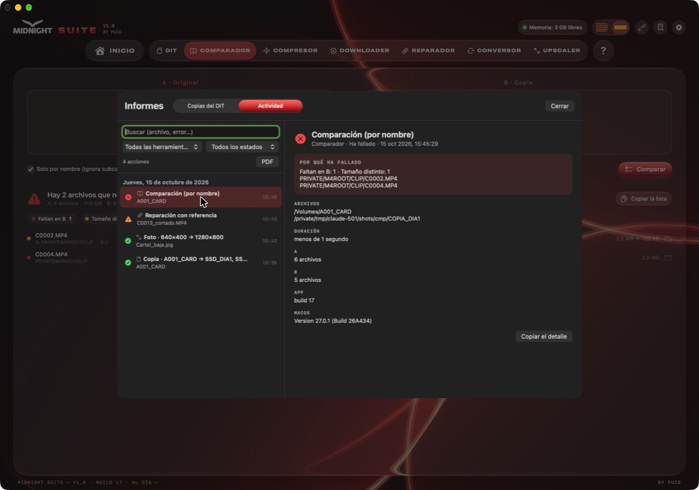
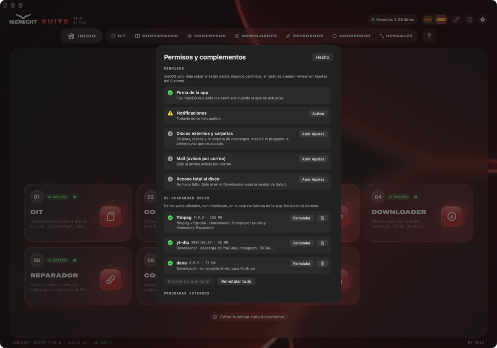

# Midnight Suite

**Las herramientas de vídeo de Midnight Group para festivales y rodajes · by Puig**

[**⬇︎ Descargar Midnight Suite para Mac**](https://github.com/paupuig92/midnight-suite/releases/latest/download/Midnight-Suite.dmg)

Mac con Apple Silicon (M1 o posterior) · macOS 14 o posterior · se actualiza sola

---

Midnight Suite reúne en una sola app todo lo que hace falta en un rodaje o en un festival: **volcar tarjetas con seguridad**, comprobar copias, comprimir y convertir archivos, descargar vídeos, reparar clips que no se abren, mejorar la resolución con la IA de Apple y **hacer subtítulos para Final Cut**.

Todo se hace **en tu Mac**: no se sube nada a internet y **el archivo original nunca se toca**.

## Novedades de la versión 1.5

- **DIT mucho más rápido**: verifica un archivo mientras copia el siguiente y lee por adelantado. Las tarjetas con muchos clips y las copias a discos externos son las que más lo notan.
- **DIT aún más seguro**: si un archivo cambia de tamaño durante la copia, o hay enlaces o rutas que no se pueden leer, la tarjeta **no** se da por buena.
- **Compresor y Conversor**: conservan todas las pistas de audio y el audio multicanal (FX6, 5.1).
- **Upscaler**: los PNG mantienen la transparencia y los vídeos de móvil ya no se desincronizan.
- **Subtítulos**: los proyectos de Final Cut con muchos compuestos ya no congelan la app.
- En reposo la app casi no consume nada, y los errores salen siempre en castellano o catalán.

## Índice

- [Novedades de la versión 1.5](#novedades-de-la-versión-15)
- [Instalación](#instalación)
- [DIT · copias de tarjetas](#dit--copias-de-tarjetas)
- [Comparador](#comparador)
- [Compresor](#compresor)
- [Conversor](#conversor)
- [Upscaler](#upscaler)
- [Subtítulos](#subtítulos)
- [Reparador](#reparador)
- [Downloader](#downloader)
- [Informes y actividad](#informes-y-actividad)
- [Permisos, complementos y requisitos](#permisos-complementos-y-requisitos)
- [Actualizaciones y seguridad](#actualizaciones-y-seguridad)
- [Preguntas frecuentes](#preguntas-frecuentes)

---

## Instalación

1. Descarga **[Midnight-Suite.dmg](https://github.com/paupuig92/midnight-suite/releases/latest/download/Midnight-Suite.dmg)**.
2. Ábrelo y arrastra **Midnight Suite** a la carpeta **Aplicaciones**.
3. La primera vez, si el Mac dice que no puede verificar la app: **Ajustes del Sistema › Privacidad y seguridad › Abrir igualmente**.
4. Listo. A partir de aquí la app **se actualiza sola**: cuando hay una versión nueva aparece un aviso arriba y se instala con un clic.

> La app está en **catalán y castellano**: se cambia con las banderas de arriba a la derecha.

¿Primera vez? El botón **?** de arriba explica cada herramienta en 3 pasos sencillos (y, si quieres, los detalles técnicos).

---

## DIT · copias de tarjetas

Hace copias de seguridad de las tarjetas de la cámara a **uno o varios discos a la vez** y comprueba que cada copia sea idéntica al original.

**Cómo se usa**

1. Pon la tarjeta en el lector: aparece sola en la columna de la izquierda.
2. Arrastra los discos (o la carpeta del día) a la columna de la derecha.
3. Pulsa **Copiar y verificar** y espera el aviso verde **«YA PUEDES BORRARLA»**.

**Lo que hace por dentro**

- La tarjeta se lee **una sola vez** y se escribe en todos los discos a la vez. Mientras copia un archivo, ya verifica el anterior y lee el siguiente.
- Cada archivo se verifica con **checksum xxHash64** (y **MD5** opcional). Opcionalmente genera un **ASC MHL**, el estándar de la industria.
- Nunca sobrescribe nada: si un clip ya está igual, se salta; si hay uno distinto con el mismo nombre, avisa.
- Si algo no se ha podido copiar o leer (un archivo que cambia de tamaño mientras se copia, un enlace simbólico, una ruta demasiado larga), lo dice y la tarjeta **no** se da por buena.
- **Copia en cascada**: primero al disco rápido y, desde él, al resto, para liberar la tarjeta antes.
- Ordena los clips en carpetas automáticamente según la cámara (`PAU`, `DRON`, `MULTI`…).
- Avisa si un lector, un cable o un disco va mucho más lento que otros días (señal de que algo empieza a fallar).
- Cada copia genera un **informe PDF** con la lista de archivos y sus checksums.

> **Nunca borres una tarjeta** hasta que la app diga «YA PUEDES BORRARLA».

---

## Comparador

Mira si dos carpetas tienen **exactamente los mismos archivos**. Sirve para saber si una copia está completa.

1. **A**: la carpeta original (por ejemplo, la tarjeta).
2. **B**: la copia que quieres comprobar.
3. Pulsa **Comparar**. En rojo, lo que falta; en naranja, lo que tiene un tamaño distinto; en verde, lo que está bien.

- **Solo por nombre**: ignora las subcarpetas (útil si en la copia los clips están repartidos en `PAU`, `DRON`…).
- **Verificar el contenido**: lee los dos lados y compara el checksum. Es más lento, pero detecta archivos corruptos aunque tengan el mismo tamaño.

---

## Compresor

Hace que los vídeos y las fotos **ocupen mucho menos sin que se note la diferencia**. Antes de empezar ya ves cuánto ocupará cada archivo y cuánto tardará.

**Vídeo**

- Pensado para **archivar BRAW y clips de DJI en H.265 10 bits** ocupando mucho menos.
- Calidad: *Archivo* (visualmente idéntico), *Alta*, *Equilibrada*, *Ligera* o un bitrate a medida.
- **Peso máximo**: escribe, por ejemplo, «25 MB» y la app calcula el bitrate para que cada vídeo quepa (ideal para webs). Si es muy pequeño, también baja la resolución.
- **BRAW** sin necesidad de plugins de pago: usa el motor oficial de Blackmagic de **DaVinci Resolve** o **Blackmagic RAW Player** (gratuitos). Puede guardarlo en *Log* para etalonar o convertirlo a *Rec.709*.
- Conserva timecode, metadatos y fechas del original, y **todas las pistas de audio** (también el audio multicanal de cámaras como la FX6 o un 5.1).

**Imagen** (al estilo de compressor.io)

- JPG, HEIC, AVIF, WebP o PNG, con o sin pérdida.
- **Peso máximo en KB o MB**: busca la mejor calidad que quepa y, si hace falta, reduce los píxeles.
- Comparación **antes / después** deslizando una línea.

---

## Conversor

Cambia el **tipo de archivo**: de MKV a MP4, de MP3 a WAV, de vídeo a GIF, de HEIC a JPG…

- **«Sin recodificar»** (en verde): el vídeo de dentro ya es compatible, así que solo se cambia el «envoltorio». Tarda segundos y **no pierde nada de calidad**.
- **«Recodificando»** (en naranja): se convierte con la máxima calidad usando el chip del Mac.
- **Vídeo**: MP4 (H.264 o HEVC), MOV, ProRes 422 / HQ / Proxy, MKV, WEBM.
- **GIF**: eliges el ancho, los fps y un **peso máximo en MB** (lo reintenta hasta que quepa).
- **Audio**: WAV, AIFF, FLAC, MP3, AAC y OGG, o sacar solo el audio de un vídeo.
- **Fotos**: JPG, PNG, HEIC, TIFF y WEBP, conservando el EXIF.

---

## Upscaler

Hace **más grandes y más nítidos** los vídeos y las fotos con la **inteligencia artificial de Apple** (macOS 26 o posterior).

- **Vídeo**: ×2, ×4, a medida o *mejorar a la misma resolución* (ideal para vídeos hechos con IA que se ven blandos en pantallas grandes). También puede pasar de 24 a 60 fps y añadir grano de película.
- **Fotos**: ×2, ×4 o a medida, con comparación antes / después. Las fotos grandes se procesan por trozos y los PNG **mantienen la transparencia**.
- Antes de empezar, la app calcula **cuánto tardará** cada vídeo.

---

## Subtítulos

Hace los **subtítulos automáticamente** y los pone en **Final Cut** como títulos que puedes editar. También saca **SRT** y **TXT** para Premiere, DaVinci, CapCut o YouTube.

1. Arrastra el **proyecto** desde el navegador de Final Cut (o cualquier vídeo o audio).
2. Elige el idioma (**catalán, castellano o inglés**) y pulsa **Analizar el audio**.
3. Corrige el texto a la derecha: puedes **partir** (tijeras) o **juntar** subtítulos.
4. Llévalo a Final Cut:
   - **Arrastra el clip compuesto** al inicio de la línea de tiempo (00:00). Doble clic para abrirlo; **⇧⌘G** separa los títulos.
   - **Añadir a la biblioteca**: crea una copia del proyecto con los subtítulos ya puestos.

**Lo que hace por dentro**

- Transcribe con **Whisper** (whisper.cpp) en tu Mac, con la GPU. No se sube nada.
- Un **detector de voz** salta música y silencios para que no se invente texto.
- Modelos: **Pequeño** (150 MB), **Mediano** (490 MB) y **Grande** (1,6 GB, el más preciso). Se descargan la primera vez y se comprueba que estén enteros.
- Reconstruye el audio del montaje a partir del proyecto de Final Cut, con compuestos y audio conectado. Los clips con cambio de velocidad o multicámara se avisan.
- Títulos **Basic Title** de serie, con tipografía, tamaño, color, contorno, sombra, posición, mayúsculas y resaltado de la palabra que se dice.

---

## Reparador

Intenta arreglar vídeos y audios que **no se abren**, por ejemplo cuando la cámara se apagó mientras grababa.

1. Arrastra el archivo: la app lo **analiza** y explica qué le pasa y si se puede salvar.
2. Si puedes, añade un **clip bueno de la misma cámara** como referencia.
3. Pulsa **Reparar**: se crea una copia reparada (`nombre_reparado`). El original no se toca.

Repara **MP4 / MOV** sin índice o cortados, **RSV de Sony**, **WAV** con la cabecera dañada, **MP3** y, en general, cualquier vídeo o audio que se pueda leer.

---

## Downloader

Descarga vídeo o música de **YouTube, Instagram, TikTok, SoundCloud, Spotify, Vimeo** y más de 1.800 webs.

1. Copia el enlace y pégalo en la caja.
2. Elige **vídeo** o **solo audio**, tal cual el original o convertido.
3. Pulsa **Descargar**. La primera vez te pregunta en qué carpeta guardar: la app solo tendrá acceso a esa carpeta.

Para Instagram o vídeos que piden iniciar sesión, elige el navegador en **Sesión del navegador** y pulsa **Probar la sesión** para comprobar que funciona.

---

## Informes y actividad

Todo lo que se hace con la app **queda registrado**: qué, con qué archivos, cómo ha terminado y, si ha fallado, **por qué**.

- **Copias del DIT**: el historial de todas las copias, con su informe PDF.
- **Actividad**: todas las herramientas. Se puede filtrar por herramienta o ver **solo los errores**, buscar por nombre de archivo y exportar a PDF.
- **Copiar el detalle**: para enviar un error a quien te ayude.
- Se guarda un año de historial.

---

## Permisos, complementos y requisitos

En **Ajustes ⚙︎ › Permisos y complementos** se ve todo lo que necesita la app y lo que falta.

- **Permisos**: notificaciones, discos y carpetas, Mail… con un botón que abre directamente el apartado de Ajustes del Sistema.
- **Complementos** que se descargan solos de sus webs oficiales (ffmpeg, yt-dlp, deno): instalar, reinstalar o borrar.
- **Programas externos** que la app detecta (DaVinci Resolve, Blackmagic RAW Player, BRAW Toolbox).
- **Requisitos de cada herramienta** comparados con tu Mac. En el Inicio, cada herramienta tiene un punto verde, amarillo o rojo.

| Herramienta | RAM mínima | Recomendada | Otros |
|---|---|---|---|
| DIT · Comparador · Downloader · Conversor | 4 GB | 8 GB | — |
| Compresor · Reparador | 8 GB | 16 GB | ffmpeg (se instala solo) · DaVinci Resolve para BRAW |
| Upscaler | 8 GB | 16 GB | macOS 26 · chip M3 o Pro/Max/Ultra recomendado |
| Subtítulos | 8 GB | 16 GB | ffmpeg · modelo de Whisper (se descarga solo) |

**Modo boost 🚀**: el botón del cohete quita las animaciones y el efecto cristal para que la app vaya más ligera (portátiles con batería o que se calientan).

---

## Actualizaciones y seguridad

- Las actualizaciones se descargan de este repositorio y van **firmadas digitalmente**: la app **no instala ninguna actualización que no esté firmada** por Midnight Group. La firma cubre también el número de versión, así que nadie puede hacer volver la app a una versión antigua.
- La lista de modelos de los Subtítulos también va firmada: la app no descarga ningún modelo que no esté en la lista firmada.
- La app está firmada siempre con el mismo certificado, así que macOS **recuerda los permisos** entre actualizaciones.
- Las herramientas pesadas (Upscaler, Compresor, Reparador) trabajan en un **proceso aparte**: si algo falla, la app y las copias del DIT siguen funcionando.
- Mientras el DIT copia, el resto de herramientas pasan a **segundo plano** para no frenar la copia.

---

## Preguntas frecuentes

**¿Se sube algo a internet?**
No. Todo se procesa en tu Mac. Solo se conecta para buscar actualizaciones, descargar los complementos y, en el Downloader, para descargar lo que le pidas.

**¿Puede estropear mis archivos originales?**
No. Ninguna herramienta modifica el original: siempre se crea un archivo nuevo al lado (o en la carpeta que elijas).

**El Mac dice que no puede verificar la app.**
Es normal: la app es interna de Midnight y no pasa por la notarización de Apple (hace falta una cuenta de desarrollador de pago). Ajustes del Sistema › Privacidad y seguridad › **Abrir igualmente**. Solo hace falta la primera vez: las actualizaciones las instala la propia app y no vuelve a salir.

**Algo ha fallado, ¿cómo pido ayuda?**
Abre **Informes › Actividad**, elige lo que ha fallado y pulsa **Copiar el detalle**. También tienes **Ajustes ⚙︎ › Copiar el registro**.

---

**Midnight Suite** · © Midnight Group · by Puig

