

# Midnight Suite

**Las herramientas de vídeo de Midnight Group para festivales y rodajes · by Puig**

### [⬇︎ Descargar Midnight Suite para Mac](https://github.com/paupuig92/midnight-suite/releases/latest/download/Midnight-Suite.dmg)

Mac con chip Apple (M1 o posterior) · macOS 14 o posterior · se actualiza sola

[¿Qué es?](#qué-es-midnight-suite) · [Instalación](#instalación-paso-a-paso) · [Herramientas](#las-herramientas) · [Seguridad](#seguridad-por-qué-puedes-fiarte) · [Preguntas](#preguntas-frecuentes) · [Novedades](#novedades)

---

## ¿Qué es Midnight Suite?

Es **una app para Mac que junta todo lo que hace falta en un rodaje o en un festival**. Copia las tarjetas de la cámara sin riesgo, comprime y convierte vídeos, estabiliza clips de dron, hace subtítulos para Final Cut y mucho más.

No hace falta saber de códecs ni usar la terminal. Arrastras el archivo, pulsas un botón y listo.

Tres cosas que se cumplen siempre:

- 🔒 **Todo pasa en tu Mac.** Tus vídeos no se suben a internet.
- 🛡️ **El original no se toca nunca.** Cada herramienta crea un archivo nuevo.
- 🔄 **Se actualiza sola.** Cuando hay una versión nueva, sale un aviso y se instala con un clic.

### Las herramientas, en una línea

| | Herramienta | Para qué sirve |
|---|---|---|
| 💾 | **[DIT](#dit--copias-de-tarjetas)** | Copiar las tarjetas de la cámara a uno o varios discos y comprobar que la copia es perfecta antes de borrar la tarjeta. |
| 🔍 | **[Comparador](#comparador)** | Saber si dos carpetas tienen exactamente los mismos archivos. |
| 🗜️ | **[Compresor](#compresor)** | Que los vídeos y las fotos ocupen mucho menos sin que se note (también BRAW). |
| 🔁 | **[Conversor](#conversor)** | Cambiar el tipo de archivo: MKV → MP4, vídeo → GIF, HEIC → JPG… |
| ✨ | **[Upscaler](#upscaler)** | Hacer los vídeos y las fotos más grandes y más nítidos con la IA de Apple. |
| 🚁 | **[Estabilizador](#estabilizador)** | Estabilizar clips de dron, GoPro y cámaras de acción con su giroscopio. |
| 🩹 | **[Reparador](#reparador)** | Arreglar vídeos y audios que no se abren. |
| 💬 | **[Subtítulos](#subtítulos)** | Subtítulos automáticos para Final Cut (y SRT para el resto de programas). |
| ⬇️ | **[Downloader](#downloader)** | Descargar vídeo o música de YouTube, Instagram, TikTok y más. |
| 🎙️ | **[Audio](#audio)** | Quitar el ruido de una voz, dejarla como de estudio o separar la voz de la música. |
| ✂️ | **[Separar clips](#separar-clips)** | Cortar el máster de Final Cut en un archivo por clip, con su nombre y su timecode. |
| ℹ️ | **[Info de clips](#info-de-clips)** | Ver todo lo que lleva un clip (cámara, ISO, timecode…) y encontrar los que fallan antes de editar. |
| 📋 | **[Historial](#historial)** | Todo lo que ha hecho la app, con informes en PDF. |

La app está en **castellano y catalán**.

---

## Instalación paso a paso

Se tarda unos 5 minutos y solo hay que hacerlo una vez. Si nunca has instalado una app fuera de la App Store, no te preocupes: vamos paso a paso.

### Paso 1. Comprueba que tu Mac es compatible

Abre **el menú Apple** (la manzana, arriba a la izquierda) y elige **Acerca de este Mac**. Se abre una ventana pequeña. Mira dos líneas:

| En la ventana pone… | ¿Sirve? |
|---|---|
| **Chip**: Apple M1, M2, M3, M4… (también Pro, Max o Ultra) | ✅ Sí |
| **Procesador**: Intel… | ❌ No. La app solo funciona en Macs con chip Apple. |
| **macOS** 14 Sonoma, 15 Sequoia, 26 Tahoe o posterior | ✅ Sí |
| **macOS** 13 Ventura o anterior | ❌ Primero actualiza el Mac: **Ajustes del Sistema › General › Actualización de software**. |

> El **Upscaler** necesita **macOS 26**. El resto de herramientas funcionan desde macOS 14.

### Paso 2. Descarga la app

Haz clic aquí: **[⬇︎ Midnight-Suite.dmg](https://github.com/paupuig92/midnight-suite/releases/latest/download/Midnight-Suite.dmg)**

El archivo se guarda en la carpeta **Descargas**. Este enlace siempre baja la última versión.

> Un archivo **.dmg** es como una caja: dentro está la app. Hay que abrir la caja y sacar la app.

### Paso 3. Pon la app en Aplicaciones

1. Ve a **Descargas** y haz **doble clic** en **Midnight-Suite.dmg**. Se abre una ventana con el icono de Midnight Suite y una carpeta **Aplicaciones**.
2. **Arrastra el icono de Midnight Suite encima de la carpeta Aplicaciones** y suelta.
3. Espera a que termine de copiarse. Después cierra la ventana.
4. En la barra lateral del Finder (o en el escritorio) verás un disco llamado **Midnight Suite**. Pulsa el botón de expulsar ⏏︎ que tiene al lado. Ya no lo necesitas.

### Paso 4. Ábrela por primera vez

Abre la carpeta **Aplicaciones** y haz doble clic en **Midnight Suite**.

La primera vez, el Mac avisa de que **no puede comprobar** la app. Es normal: más abajo te explicamos [por qué](#seguridad-por-qué-puedes-fiarte).

> ⚠️ **No pulses «Trasladar a la papelera».** Cierra el aviso con el otro botón y sigue los pasos de tu versión de macOS.

**Si tienes macOS 15 Sequoia o posterior (también macOS 26 Tahoe):**

1. Abre **Ajustes del Sistema › Privacidad y seguridad**.
2. Baja hasta el final de la ventana. Verás un mensaje sobre Midnight Suite.
3. Pulsa **Abrir igualmente** y confirma con tu contraseña del Mac o con Touch ID.
4. Vuelve a abrir la app. Si sale un último aviso, pulsa el botón para abrirla (no el de la papelera).

**Si tienes macOS 14 Sonoma:**

1. En **Aplicaciones**, haz **clic derecho** (o Control + clic) sobre Midnight Suite.
2. Elige **Abrir**.
3. En el aviso, pulsa otra vez **Abrir**.

Esto solo pasa **la primera vez**. Las actualizaciones las instala la propia app y el aviso no vuelve a salir.

### Paso 5. Lo que te pregunta la app al empezar

**Si la abriste desde Descargas o desde el disco del .dmg**, la app te pregunta: *«¿Quieres mover Midnight Suite a Aplicaciones?»*. Pulsa **Moverla a Aplicaciones**. Así macOS recuerda los permisos y las actualizaciones se instalan solas.

**Después sale la ventana «Antes de empezar»**, con tres cosas:

1. **Avisos**: pulsa **Activar los avisos**. Así la app te avisa cuando termina una copia o una herramienta, aunque estés en otra app.
2. **Permiso para las tarjetas**: la primera vez que copies una tarjeta, macOS te preguntará si Midnight Suite puede acceder a los volúmenes extraíbles. Pulsa **Permitir**. Si no, el DIT no podrá leerla.
3. **Complementos**: algunas herramientas necesitan programas extra. Pulsa **Instalar lo que falta** y la app los descarga sola, de sus webs oficiales y comprobados. Puedes seguir trabajando mientras tanto.

Cuando acabes, pulsa **Empezar**.

> Los complementos incluyen el modelo de los Subtítulos (unos 1,6 GB) y Gyroflow (unos 90 MB). Mejor hacerlo con una buena conexión, por ejemplo en la oficina antes de salir.

### Cambiar el idioma

Abre **Ajustes** (el botón del engranaje ⚙︎ arriba a la derecha, o **⌘,**) › **General** › **Idioma**, y elige **CAT** o **ESP**. El cambio es inmediato.

### Dónde está la ayuda

- **Guía**: cada herramienta explicada en 3 pasos. Ábrela con el botón **?** de abajo a la derecha de cada herramienta, o en el menú **Ayuda › Guía de Midnight Suite** (**⌘?**).
- **Acerca de** y **Novedades**: en el menú **Midnight Suite** (arriba, al lado de la manzana).

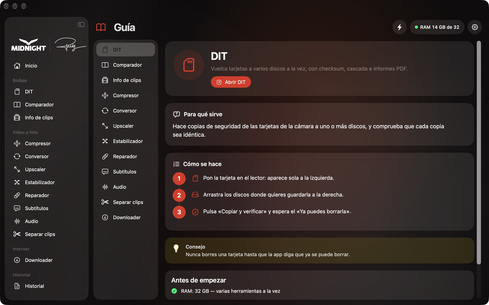

### Actualizaciones

No hace falta volver a esta página. Cuando hay una versión nueva:

- Sale un **aviso arriba** en la app, con el número de la versión. Pulsa **Actualizar** (o **Más tarde** si estás ocupado).
- La app se cierra, se actualiza y se vuelve a abrir.

También puedes buscarla tú: menú **Midnight Suite › Buscar actualizaciones…**, o **Ajustes › Actualizaciones**.

> Si hay una copia del DIT o una herramienta trabajando, la app espera a que termine antes de actualizarse. Así no se corta nada.

### Si algo no va bien

<b>No aparece el botón «Abrir igualmente»</b>

Primero intenta abrir la app (doble clic en Aplicaciones) y cierra el aviso. **Justo después**, ve a **Ajustes del Sistema › Privacidad y seguridad** y baja hasta el final. El botón solo sale después de intentar abrir la app.

En macOS 15 o posterior, el truco del clic derecho › Abrir ya no sirve: usa **Privacidad y seguridad**.

<b>He pulsado «Trasladar a la papelera» sin querer</b>

No pasa nada. Vuelve a descargar el [.dmg](https://github.com/paupuig92/midnight-suite/releases/latest/download/Midnight-Suite.dmg) y repite desde el [paso 3](#paso-3-pon-la-app-en-aplicaciones).

<b>Tengo un Mac con Intel</b>

Lo sentimos: ahora mismo la app solo funciona en Macs con chip Apple (M1 o posterior).

<b>La app dice que la mueva a Aplicaciones para actualizarse</b>

Las actualizaciones solo se instalan si la app está en la carpeta **Aplicaciones**. Ciérrala, arrástrala a Aplicaciones desde el Finder (si te pregunta, elige **Reemplazar**) y ábrela desde allí.

<b>Una herramienta tiene un punto amarillo o rojo</b>

Le falta algo: un complemento, un permiso o más memoria. Pasa el ratón por encima del punto para ver qué es, o haz clic en él: se abre **Ajustes** en la pestaña que lo arregla (**Complementos** o **Tu Mac**).

<b>He instalado Gyroflow desde la App Store y el Estabilizador no lo encuentra</b>

La versión de la App Store no sirve. Instala Gyroflow desde el propio Estabilizador (un botón, unos 90 MB).

---

## Las herramientas

En la barra lateral están ordenadas en grupos: **Rodaje** (DIT, Comparador e Info de clips), **Vídeo y foto** (Compresor, Conversor, Upscaler, Estabilizador, Reparador, Subtítulos, Audio y Separar clips), **Internet** (Downloader) e **Historial**.

Cada una tiene un atajo: **⌘1** a **⌘9** en ese orden (de DIT a Subtítulos), **⌥⌘1** Audio, **⌥⌘2** Separar clips, **⌥⌘3** Downloader, **⌘0** para el Inicio y **⌘⇧R** para el Historial.

### DIT · copias de tarjetas

Hace copias de seguridad de las tarjetas de la cámara en **uno o varios discos a la vez**, y comprueba que cada copia sea idéntica al original.

1. Pon la tarjeta en el lector. Aparece sola a la izquierda.
2. Arrastra a la derecha los discos donde quieres guardarla.
3. Pulsa **Copiar y verificar** y espera el aviso verde **«Ya puedes borrarla»**.

> **Nunca borres una tarjeta** hasta que la app diga «Ya puedes borrarla».

<b>Más detalles</b>

- La tarjeta se lee **una sola vez** y se escribe en todos los discos a la vez.
- Cada archivo se comprueba con **checksum xxHash64** (y **MD5** si lo activas). Puede guardar un **ASC MHL**, el formato estándar que piden algunas productoras.
- Antes de dar la tarjeta por buena, comprueba que **cada clip se abre de verdad**.
- Con dos discos o más, «Ya puedes borrarla» solo sale cuando hay **dos copias verificadas**. Dos copias en el mismo disco cuentan como una.
- Nunca sobrescribe nada: si un clip ya está igual, se lo salta; si hay uno distinto con el mismo nombre, avisa.
- Si algo no se ha podido copiar o leer, lo dice y la tarjeta **no** se da por buena.
- Botones **Rápida** (copia sin volver a leer), **Verificar** y **Expulsar**. Después de una Rápida, **Verificar** compara las copias con el checksum guardado al copiar, sin volver a leer la tarjeta.
- Copiar a un **NAS** por red (SMB) también es seguro: al terminar cada clip, la app comprueba que el NAS lo deja leer.
- **Copia en cascada**: primero al disco rápido y, desde él, al resto, para liberar la tarjeta antes.
- Carpetas automáticas por día, cámara y rollo; **nota** por tarjeta y **sesión de rodaje** («FIB 2026 · Día 3»).
- Avisa si un lector, un cable o un disco va mucho más lento que otros días.
- Cada copia genera un **informe PDF** con la lista de archivos, sus checksums y una miniatura de cada clip.
- En **Ajustes › General** puedes pedir también proxies, guardar el informe en el disco de destino o expulsar la tarjeta sola cuando ya es segura.
- **¿Listo para el festival?**: una comprobación de un clic antes de salir.

### Comparador

Mira si dos carpetas tienen **exactamente los mismos archivos**. Sirve para saber si una copia está completa.

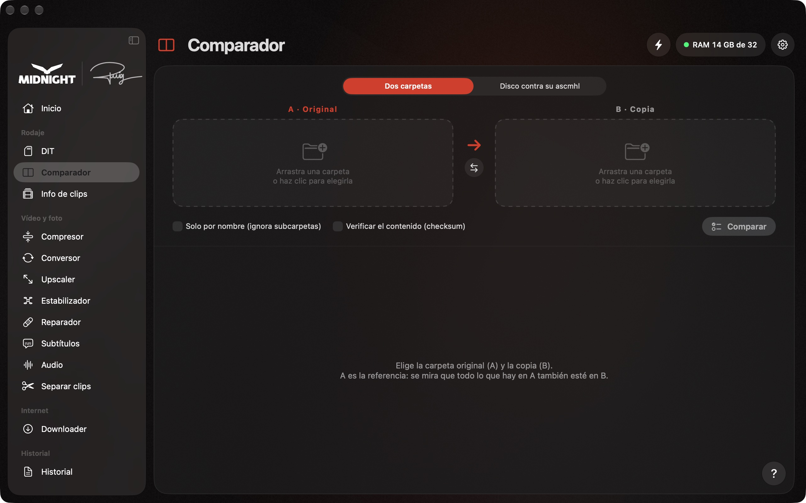

1. **A**: la carpeta original (por ejemplo, la tarjeta).
2. **B**: la copia que quieres comprobar.
3. Pulsa **Comparar**. En rojo, lo que falta o está mal; en naranja, lo que tiene un tamaño distinto; en verde, lo que está bien.

<b>Más detalles</b>

- **Solo por nombre**: ignora las subcarpetas. Útil si en la copia los clips están en otras carpetas (`PAU`, `DRON`…).
- **Verificar el contenido (checksum)**: lee los dos lados enteros. Es más lento, pero detecta archivos corruptos aunque tengan el mismo tamaño.
- **Disco contra su ascmhl**: compara un disco copiado con el DIT con su lista de checksums, aunque la tarjeta ya no esté.

### Compresor

Hace que los vídeos y las fotos **ocupen mucho menos sin que se note**. Antes de empezar ya ves cuánto ocupará cada archivo.

1. Arrastra vídeos o fotos a la ventana.
2. Elige la calidad o el peso máximo que quieres (por ejemplo, 500 KB para una web).
3. Pulsa **Comprimir**.

<b>Más detalles</b>

**Vídeo**

- Pensado para **archivar BRAW y clips de DJI en H.265 10 bits** ocupando mucho menos.
- Calidad: *Archivo* (visualmente idéntica), *Alta*, *Equilibrada*, *Ligera* o un bitrate a medida.
- **Peso máximo**: escribe, por ejemplo, «25 MB» y la app calcula el bitrate para que cada vídeo quepa. Si hace falta, también baja la resolución.
- **BRAW** sin plugins de pago y en la GPU, con el motor oficial de Blackmagic que viene con **DaVinci Resolve** o **Blackmagic RAW Player** (gratuitos). Puede guardarlo en *Log* o pasarlo a *Rec.709*, y aplicar una **LUT .cube**.
- Conserva timecode, metadatos, fechas y **todas las pistas de audio**.

**Imagen**

- JPG, HEIC, AVIF, WebP o PNG, con o sin pérdida.
- **Peso máximo en KB o MB**: busca la mejor calidad que quepa y, si hace falta, reduce los píxeles.
- Comparación **antes / después** deslizando una línea.

### Conversor

Cambia el **tipo de archivo**: de MKV a MP4, de MP3 a WAV, de vídeo a GIF, de HEIC a JPG…

1. Arrastra los archivos.
2. Elige a qué formato los quieres (pestañas **Vídeo**, **Audio** o **Fotos**).
3. Pulsa **Convertir**. El archivo nuevo aparece junto al original.

> Si pone **«Sin recodificar»**, se hace en segundos y sin perder nada de calidad.

<b>Más detalles</b>

- **«Sin recodificar»** (en verde): el vídeo de dentro ya es compatible, así que solo cambia el «envoltorio».
- **«Recodificando»** (en naranja): se convierte con la máxima calidad usando el chip del Mac.
- **Vídeo**: MP4 (H.264 o HEVC), MOV, ProRes 422 / HQ / Proxy, MKV, WEBM y **DXV** para Resolume.
- **GIF**: eliges el ancho, los fps y un **peso máximo en MB**.
- **Audio**: WAV, AIFF, FLAC, MP3, AAC y OGG, o sacar solo el audio de un vídeo. Puede **normalizar el volumen** para redes o TV.
- **Fotos**: JPG, PNG, HEIC, TIFF y WEBP, conservando el EXIF.
- **Recortar** el inicio y el final, y **copia de revisión** con timecode y marca.

### Upscaler

Hace **más grandes y más nítidos** los vídeos y las fotos con la **inteligencia artificial de Apple**. Necesita **macOS 26**.

1. Arrastra vídeos o fotos (pestaña **Vídeo** o **Fotos**).
2. Elige cuánto más grande: ×2, ×4 o un tamaño concreto.
3. Pulsa **Empezar**.

> Los vídeos largos tardan. La app te dice cuánto antes de empezar.

<b>Más detalles</b>

- **Vídeo**: ×2, ×4, a medida o *mejorar a la misma resolución* (ideal para vídeos hechos con IA que se ven blandos). También puede pasar de 24 a 60 fps y añadir grano de película.
- **Fotos**: ×2, ×4 o a medida, con comparación antes / después. Los PNG **mantienen la transparencia**.
- **Prueba de 5 s**: mira cómo queda un trozo antes de hacer el vídeo entero.
- Conserva el timecode.

### Estabilizador

Estabiliza clips de **drones, GoPro y cámaras de acción** con los datos del giroscopio que guarda la cámara. Lo hace con **Gyroflow**.

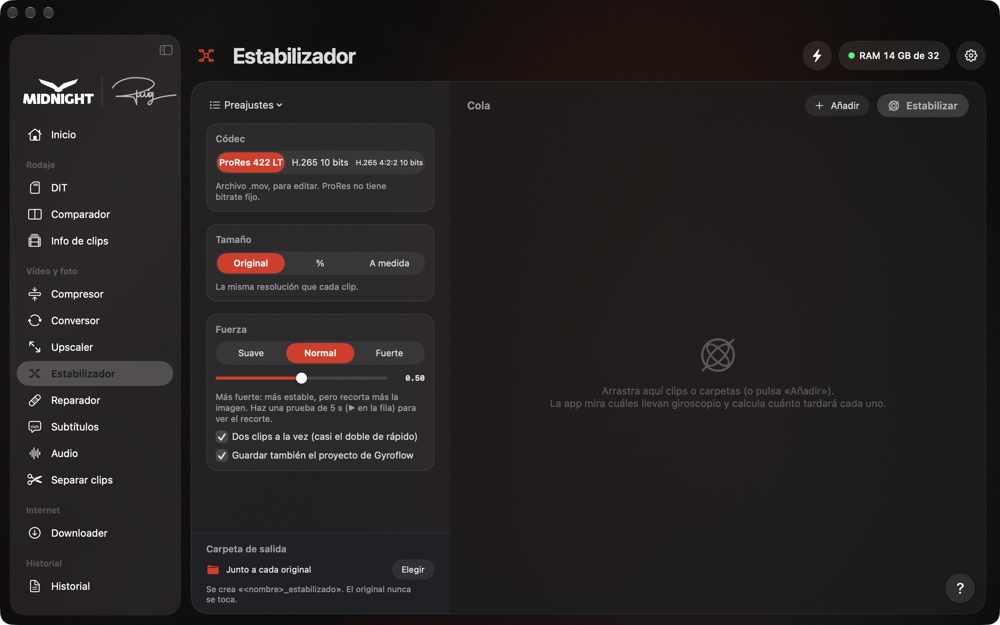

1. Arrastra clips o carpetas. La app mira cuáles llevan datos del giroscopio.
2. Elige el códec, el tamaño y la suavidad.
3. Pulsa **Estabilizar**. Se hacen de dos en dos (casi el doble de rápido) y ves cuánto falta. Si mientras tanto necesitas el Mac para otras cosas, desmarca «Dos clips a la vez».
   Si solo quieres algunos, desmarca la casilla de los demás: el botón dice cuántos se harán, por ejemplo «Estabilizar (3)».

> La primera vez hay que instalar Gyroflow: un botón dentro de la app, unos 90 MB.

<b>Más detalles</b>

- Formatos de salida: ProRes 422 LT o H.265.
- **Prueba de 5 s**: mira el recorte y si aún tiembla antes de hacerlo todo.
- Crea una copia (`nombre_estabilizado`) y guarda también el proyecto de Gyroflow.
- Gyroflow se descarga de su web oficial y se comprueba. La versión de la App Store no sirve.

### Reparador

Intenta arreglar vídeos y audios que **no se abren**, por ejemplo cuando la cámara se apagó mientras grababa.

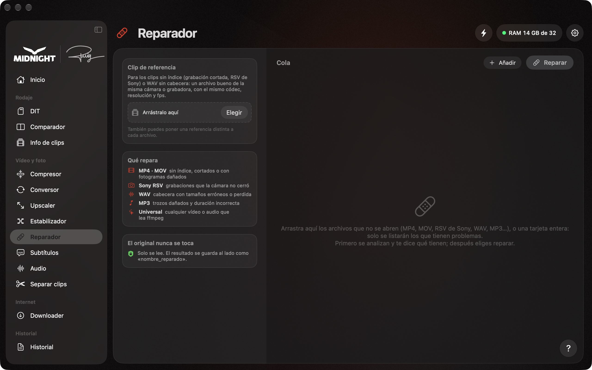

1. Arrastra el archivo que no se abre (o una carpeta entera). La app te explica qué le pasa y si se puede salvar.
2. Si puedes, añade un **clip bueno de la misma cámara** como referencia.
3. Pulsa **Reparar**. Se crea una copia arreglada (`nombre_reparado`).

<b>Qué puede reparar</b>

**MP4 / MOV** sin índice o cortados, **RSV de Sony**, **WAV** con la cabecera dañada, **MP3** y, en general, cualquier vídeo o audio que se pueda leer.

### Subtítulos

Hace los **subtítulos automáticamente** y los pone en **Final Cut** como títulos que puedes editar. También saca **SRT** y **TXT** para Premiere, DaVinci, CapCut o YouTube.

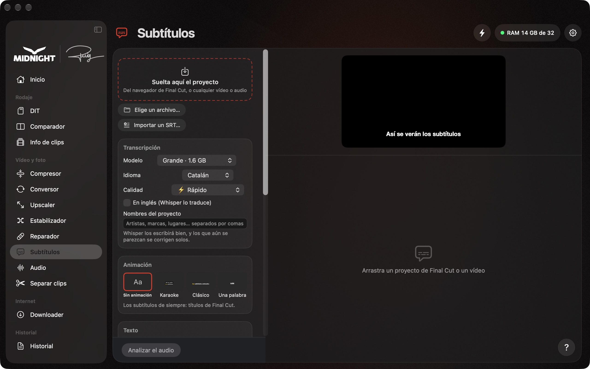

1. Arrastra el **proyecto** desde el navegador de Final Cut (o cualquier vídeo o audio).
2. Elige el idioma (**catalán, castellano o inglés**) y pulsa **Analizar el audio**. Corrige lo que haga falta a la derecha.
3. Arrastra los subtítulos al inicio de la línea de tiempo (00:00), o pulsa **Añadir a la biblioteca**.

<b>Más detalles</b>

- Transcribe con **Whisper** en tu Mac, con la GPU. No se sube nada.
- Un **detector de voz** se salta la música y los silencios para no inventarse texto.
- Modelos: **Pequeño** (150 MB), **Mediano** (490 MB) y **Grande** (1,6 GB, el más preciso en catalán). Se descargan la primera vez.
- Puedes **partir** (tijeras) o **juntar** subtítulos, **buscar y reemplazar**, **importar un SRT** y **traducir al inglés**.
- Títulos **Basic Title** de serie, con tipografía, tamaño, color, contorno, sombra, posición y resaltado de la palabra que se dice.

### Downloader

Descarga vídeo o música de **YouTube, Instagram, TikTok, SoundCloud, Spotify, Vimeo** y más de 1.800 webs.

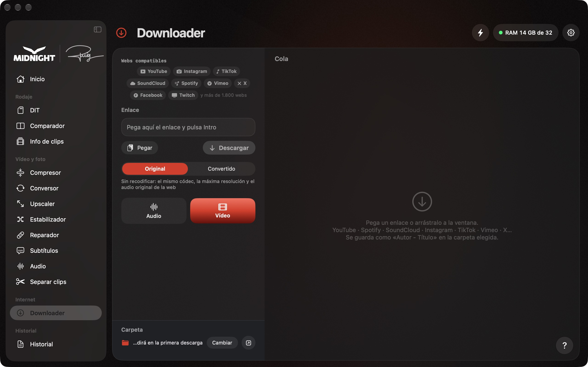

1. Copia el enlace del vídeo y pégalo en la caja.
2. Elige si quieres el **vídeo** o **solo el audio** (entero o solo un trozo).
3. Pulsa **Descargar**. La primera vez te pregunta en qué carpeta guardar.

> Para Instagram (y algunos vídeos que piden iniciar sesión), elige tu navegador en **Sesión del navegador** y pulsa **Probar la sesión**. Tienes que haber entrado en tu cuenta con ese navegador.

### Audio

**Limpia la voz** de entrevistas y vídeos, la deja **como de estudio** o **separa la voz de la música**. Todo en tu Mac, sin internet.

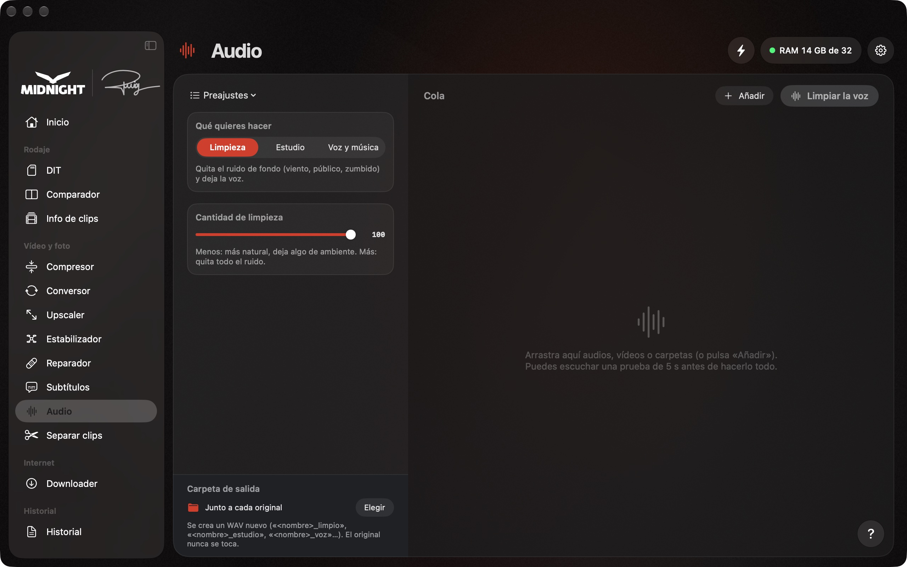

1. Arrastra los audios o vídeos (WAV, MP3, MP4, MOV…).
2. Elige qué quieres: **Limpieza de voz**, **Voz de estudio** o **Voz y música**.
3. Pulsa **Limpiar la voz**, **Mejorar** o **Separar**. Con 🎧 puedes escuchar 5 s de prueba (antes y después) sin hacer el archivo entero.

<b>Más detalles</b>

- **Limpieza de voz** usa DeepFilterNet 3 (libre): quita el ruido de fondo y deja la voz. «Cantidad de limpieza» dice cuánto ruido puede quitar.
- **Voz de estudio**: después de la limpieza, filtro de graves, EQ de voz, de-esser, compresor y volumen final en LUFS (Podcast −16, Broadcast −23, Redes −14 o sin cambio). Mejora una voz ya limpia; no reconstruye una voz de teléfono.
- **Voz y música** usa Demucs v4 (libre) en la GPU del Mac: salen «_voz» e «_instrumental», o cinco pistas con batería, bajo y el resto. El modelo (79 MB) se descarga la primera vez.
- Sale un WAV de 24 bits con la misma frecuencia y duración que el original, alineado con el vídeo. El original nunca se toca.

### Separar clips

Corta el **máster de Final Cut** en **un archivo por clip**, con el nombre y el timecode de la cámara. Útil para entregar los planos montados por separado.

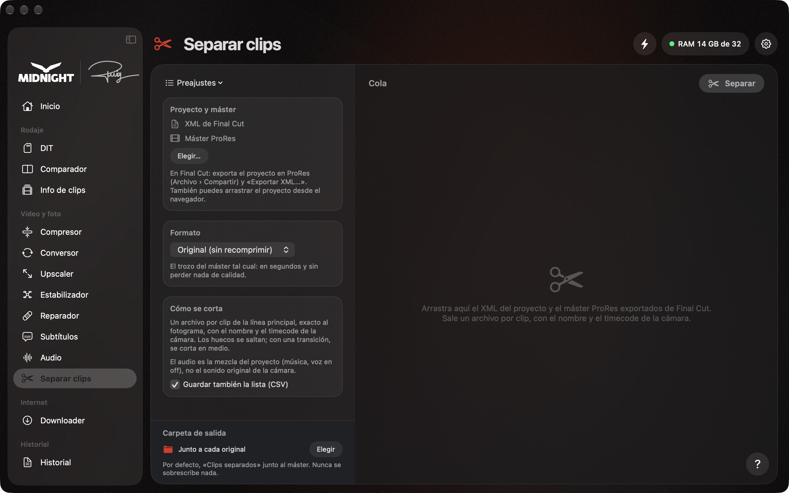

1. En Final Cut, exporta el proyecto en **ProRes** (Archivo › Compartir) y el **XML** (Archivo › Exportar XML…).
2. Arrastra el XML y el máster a la ventana (o el proyecto directamente desde el navegador de Final Cut).
3. Pulsa **Separar**. Por defecto, los clips salen en una carpeta «Clips separados» junto al máster.

<b>Más detalles</b>

- Un archivo por cada clip de la línea principal, exacto al fotograma. Los huecos se saltan; con una transición, se corta en medio.
- **Original (sin recomprimir)**: el trozo del máster tal cual, en segundos y sin perder calidad.
- El audio es la mezcla del proyecto (música, voz en off), no el sonido original de la cámara.
- Puede guardar también la lista de clips en **CSV**. Nunca sobrescribe nada.

### Info de clips

Lee la **información de cada clip** (cámara, ISO, obturación, gamma, timecode, audio…) y **avisa de lo que falla** antes de empezar a editar.

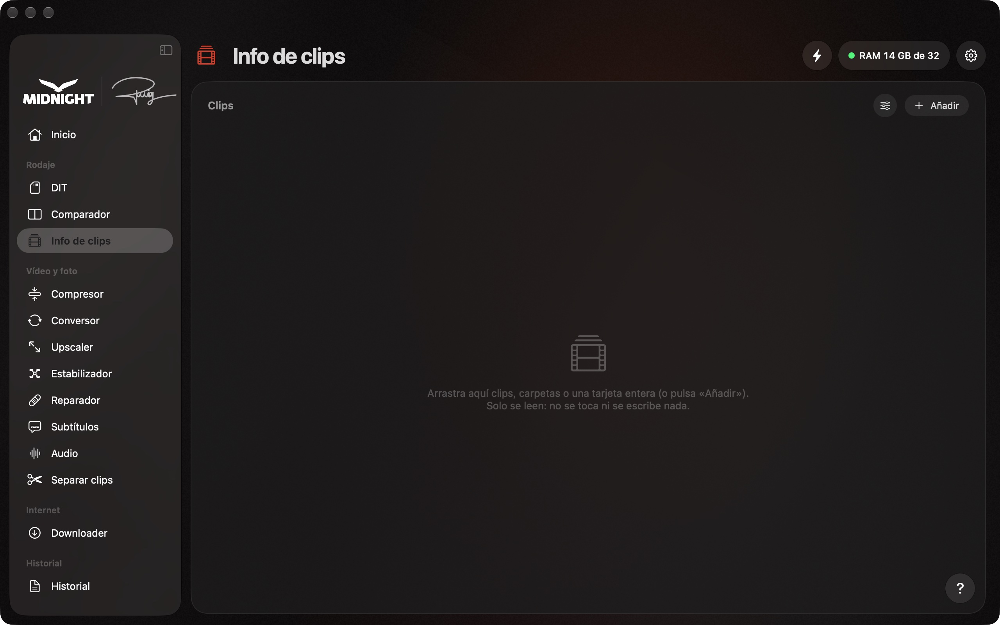

1. Arrastra los clips o la carpeta de la tarjeta (MP4, MOV, MXF, BRAW, WAV, MP3).
2. Mira la **tabla**: un clip por fila; en amarillo, lo que no coincide con el resto (resolución, fps, códec, gamma o audio).
3. Pulsa un clip para ver el detalle, o **Analizar entero** para descodificarlo todo. Con **Exportar** sacas un JSON, un CSV o un PDF.

<b>Más detalles</b>

- Los datos salen de MediaInfo (libre), dentro de la app. El archivo solo se lee: nunca se escribe nada en él.
- Cámaras: Sony (ISO, obturación, diafragma, S-Log3…), Blackmagic (cámara, óptica, rollo), DJI (ISO, obturación, balance de blancos, D-Log y GPS) e iPhone (modelo y GPS).
- Alertas: fps variable, cámara lenta o rápida, clips sin timecode, audio desfasado y el clip distinto del resto.
- **Analizar entero** avisa de archivos incompletos, saltos de tiempo, imagen congelada, negros, sobreexposición y, en el audio, silencio, saturación, canales idénticos y fase invertida. Nunca se hace mientras el DIT copia.
- El CSV sigue las columnas y el orden de la tabla. El GPS solo sale si activas «Incluir el GPS al exportar».

### Historial

Todo lo que hace la app **queda apuntado**: qué, con qué archivos, cómo ha terminado y, si ha fallado, **por qué**.

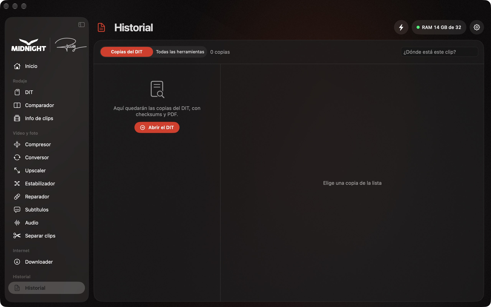

- **Copias del DIT**: todas las copias, con su informe PDF.
- **Actividad**: todas las herramientas. Puedes filtrar por herramienta o por estado, buscar un archivo o un error, y exportar a PDF.
- **¿Dónde está este clip?**: escribe el nombre de un clip y te dice en qué discos se copió.
- **Copiar el detalle**: para enviar un error a quien te ayude.

---

## Requisitos y permisos

En **Ajustes** (⌘,) tienes tres pestañas que te dicen qué necesita la app y qué te falta, con un botón para arreglarlo:

- **Permisos**: avisos, discos y carpetas… Con un botón que abre el apartado justo de los Ajustes del Sistema.
- **Complementos**: los programas que la app descarga sola (ffmpeg, yt-dlp, deno) y los programas externos (DaVinci Resolve, Blackmagic RAW Player, BRAW Toolbox y Gyroflow).
- **Tu Mac**: lo que pide cada herramienta, comparado con tu Mac.

Esto es lo que pide cada herramienta:

| Herramienta | Memoria (RAM) mínima | Para usar varias a la vez | Además necesita |
|---|---|---|---|
| DIT · Comparador | 4 GB | 8 GB | — |
| Conversor | 4 GB | 8 GB | ffmpeg (complemento) |
| Downloader | 4 GB | 8 GB | yt-dlp, deno y ffmpeg (complementos) |
| Compresor | 8 GB | 16 GB | ffmpeg recomendado · DaVinci Resolve (gratuito) para BRAW · 50 GB libres recomendados |
| Reparador | 8 GB | 16 GB | ffmpeg (se instala solo al reparar el primer archivo) |
| Estabilizador | 8 GB | 16 GB | Gyroflow (un botón, unos 90 MB) · 50 GB libres recomendados |
| Upscaler | 8 GB | 16 GB | **macOS 26** · chip M3 o un Pro/Max/Ultra recomendado · 50 GB libres recomendados |
| Subtítulos | 8 GB | 16 GB | ffmpeg · modelo de Whisper (se descarga la primera vez) · 3 GB libres para los modelos |

Con **8 GB** funcionan todas las herramientas, una pesada cada vez. Con **16 GB o más** pueden trabajar varias a la vez.

**Memoria con semáforo**: el indicador de memoria, arriba, sigue lo que dice macOS. 🟢 Verde: las herramientas trabajan con normalidad. 🟡 Amarillo: el Mac va justo y trabaja una sola herramienta cada vez (el DIT también cuenta); puede ir más lenta. 🔴 Rojo: no empieza ninguna y la que trabaja avisa de que el Mac se ha quedado sin memoria (cierra otras apps).

¿Cuánta memoria tiene tu Mac? Menú Apple (la manzana) › **Acerca de este Mac** › línea **Memoria**.

**Modo boost ⚡**: el botón del rayo, arriba a la derecha, da toda la potencia del Mac a una sola herramienta. Las demás esperan en la cola y el Mac no se duerme. Al abrir la app siempre está apagado.

**Interfaz ligera**: en **Ajustes › Apariencia** puedes quitar el efecto cristal y las animaciones. La app gasta menos gráfica y menos batería.

---

## Seguridad: por qué puedes fiarte

La primera vez, el Mac avisa de que no puede comprobar la app. Sale porque la app **no está notarizada por Apple** (para eso hace falta una cuenta de desarrollador de pago). Esto es lo que sí tiene:

- **Actualizaciones firmadas.** Cada actualización lleva una firma digital (**Ed25519**) hecha con una clave que solo tiene Puig. La app **no instala nada que no esté firmado**, aunque alguien entrara en este repositorio. La firma cubre el archivo, el número de versión (nadie puede hacerte volver a una versión antigua) y el texto del aviso.
- **Vuelta atrás automática.** Si una versión nueva no arranca, la app **vuelve sola a la anterior**.
- **Complementos de fuentes oficiales.** ffmpeg, yt-dlp, deno, Gyroflow y los modelos de Whisper se descargan solo de sus webs oficiales y se comprueban antes de usarlos.
- **Las herramientas pesadas van aparte.** Trabajan en un proceso separado: si una falla, la app y las copias del DIT siguen funcionando.

Descarga la app **solo desde esta página** o desde el enlace que te pase Puig.

---

## Preguntas frecuentes

**¿Se sube algo a internet?**
No. Todo se procesa en tu Mac. La app solo se conecta para buscar actualizaciones, descargar los complementos y, en el Downloader, para bajar lo que le pidas.

**¿Puede estropear mis archivos originales?**
No. Ninguna herramienta cambia el original: siempre se crea un archivo nuevo al lado (o en la carpeta que elijas).

**¿Tengo que volver a esta página para actualizar?**
No. La app avisa sola cuando hay una versión nueva. Ver [Actualizaciones](#actualizaciones).

**¿Por qué el Mac dice que no puede comprobar la app?**
Porque no está notarizada por Apple. Te lo explicamos en [Seguridad](#seguridad-por-qué-puedes-fiarte).

**¿Dónde están la Guía, «Acerca de» y las «Novedades»?**
La **Guía**, en el menú **Ayuda** (**⌘?**) o en el botón **?** de cada herramienta. **Acerca de Midnight Suite** y **Novedades**, en el menú **Midnight Suite** (arriba, al lado de la manzana).

**Algo ha fallado. ¿Cómo pido ayuda?**
Abre **Historial › Actividad**, elige lo que ha fallado y pulsa **Copiar el detalle**. También puedes pulsar **Copiar el registro** en **Ajustes › Actualizaciones**. Pégalo en un correo o un mensaje y envíaselo a Puig.

---

## Novedades

Dentro de la app tienes la historia completa, versión a versión: menú **Midnight Suite › Novedades**.

### Versión 2.2

- **Mac de 8 GB**: las herramientas (Subtítulos, Compresor, Upscaler, Estabilizador, Reparador) ya no se quedan esperando memoria para siempre.
- **Memoria con semáforo**: en verde pueden trabajar varias herramientas a la vez; en amarillo, una sola (el DIT también cuenta); en rojo no empieza ninguna, y la que trabaja avisa de que el Mac se ha quedado sin memoria.
- La app **aprende cuánta memoria gasta de verdad** cada trabajo y pide justo esa.
- **Panel de memoria más claro**, y la RAM sale en verde en los Mac de 8 GB (una herramienta pesada cada vez).
- Después de actualizar, **las copias viejas de la app van a la Papelera**.

### Versión 2.1.4

- **Upscaler**: cada clip de la cola muestra en etiquetas rojas con qué ajustes se hace (Mejora, ×2 o ×4, Máxima o Rápida, grano y códec). Los que ya están en marcha o hechos se quedan con los suyos aunque cambies el panel.
- **Barra lateral**: la firma de Puig sustituye a «SUITE by Puig» y se escribe sola al pasar el ratón; el logo MIDNIGHT hace una pequeña animación de luz.
- **Avisos**: ya no salen con el icono viejo «DIT».

### Versión 2.1.3

- **Upscaler más rápido**: con IA y más fotogramas por segundo (por ejemplo «Mejora» a 60 fps), la IA se hace solo en los fotogramas reales y después se inventan los intermedios. Entre 2 y 3,5 veces más rápido, el grano ya no queda difuminado y el tiempo estimado es más exacto.
- **Upscaler**: con el boost encendido antes de empezar, los vídeos ya no se quedan «En espera» para siempre.
- **DIT**: opción «Personalizado…» en el menú de la carpeta para escribir su nombre.

### Versión 2.1.2

- **DIT a un NAS (SMB)**: la app ya no bloquea los archivos que copia (el bloqueo podía quedarse en el servidor y nadie podía abrir los clips) y, al terminar cada clip, comprueba que el NAS lo deja leer, también en «Rápida».
- **Verificar más rápido**: después de una «Rápida» ya no vuelve a leer la tarjeta; compara las copias con el checksum guardado al copiar. En Ajustes se puede pedir que la relea.
- **Mensajes más claros**: «no se puede leer» en lugar de «checksum diferente» cuando un archivo no se puede leer, y «Copiar y verificar» lo detecta enseguida.
- **DaVinci Resolve, Blackmagic RAW Player y BRAW Toolbox** se detectan también instalados desde la web, y también Resolve Studio.
- **Estabilizador**: hace 2 clips a la vez (casi el doble de rápido; se puede desactivar), casilla en cada clip para elegir cuáles se hacen, y los clips de un NAS se leen de tres en tres.
- **DIT**: una ✕ en cada copia terminada para quitarla de la lista; las imágenes de disco (.dmg) ya no se abren como tarjetas.
- «Instalar lo que falta» y «Preajustes» (antes «Prepáralo todo para el rodaje» y «Recetas»).

### Versión 2.1.1

- **DIT**: si la columna es estrecha, «Rápida», «Verificar» y «Expulsar» se quedan solo con el icono (el texto sale al pasar el ratón), en lugar de partirse letra a letra.
- **DIT**: «Rápida» ya tiene forma de botón, como «Verificar» y «Expulsar».

### Versión 2.1

- **DIT que comprueba cada clip**: antes de decir «Ya puedes borrarla» se comprueba que cada clip se abre de verdad, y el PDF lleva una miniatura de cada clip.
- **DIT más claro**: dos copias en el mismo disco ya no cuentan como dos; un disco que no se puede leer sale como «ilegible»; parar la copia pide confirmación; «Se copia en:» muestra la ruta real; el progreso sale en el icono del Dock; la tarjeta se expulsa sola cuando ya es segura.
- **Para el rodaje**: nota por tarjeta, carpetas automáticas por día, cámara y rollo, sesión de rodaje («FIB 2026 · Día 3»), proxies al terminar e informe guardado en el disco de destino.
- **¿Listo para el festival?**: una comprobación de un clic antes de salir.
- **Avisos**: Telegram desaparece; el correo lleva el nombre del Mac, avisa si falla y también llega cuando termina una herramienta larga. Notificaciones con «Abrir el informe» y «Mostrar en el Finder».
- **Actualizaciones más seguras**: si una versión nueva no arranca, la app vuelve sola a la anterior; ffmpeg, yt-dlp y Gyroflow se comprueban cada vez.
- **Compresor**: LUT .cube para material log y BRAW en la GPU (más de 2× más rápido). **Conversor**: normalizar el volumen, recortar y copia de revisión.
- **Upscaler y Estabilizador**: prueba de 5 segundos «Antes / Después»; el Estabilizador guarda también el proyecto de Gyroflow.
- **Subtítulos**: buscar y reemplazar, importar SRT y traducción al inglés. **Reparador**: carpetas enteras. **Downloader**: solo un trozo.
- **Historial** con «¿Dónde está este clip?», «Enviar a…» en cada archivo terminado, preajustes guardados por herramienta y archivos soltados en el icono del Dock.
- Interfaz más coherente, barra lateral más corta y más de 15 errores arreglados.

<b>Versión 2.0</b>

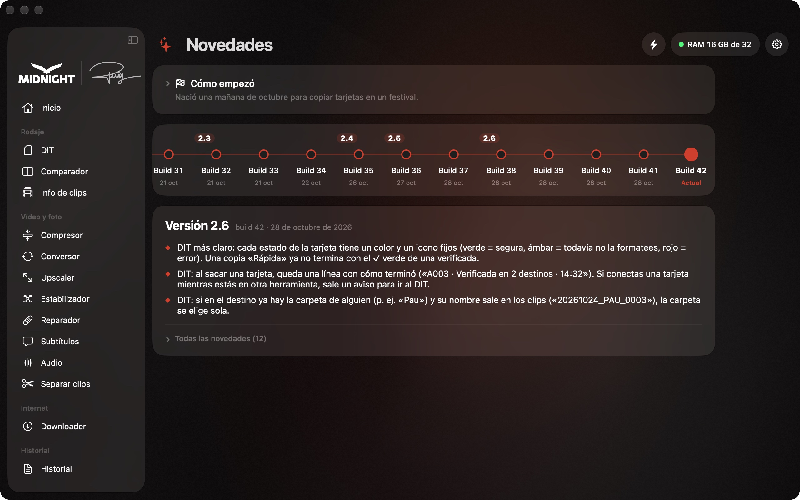

- **Diseño nuevo**, al estilo de las apps de Apple, con barra lateral flotante.
- **Inicio nuevo**, con el progreso de cada herramienta en grande.
- **Modo claro y oscuro**, **Ajustes en su propia ventana** (⌘,) y **modo boost** (⚡).
- **DIT más seguro**: dos copias verificadas antes de «Ya puedes borrarla», tarjetas reconocidas por su identificador y copias cortadas que se reanudan solas.
- **ASC MHL según el estándar** y PDF con todos los destinos, velocidades y errores.
- **Más rápido en Apple Silicon**: Conversor y Downloader con el chip de vídeo del Mac.
- El **Estabilizador** y el **Upscaler** conservan el timecode.
- **Atajos** ⌘0–⌘9 para cada herramienta y una pantalla «Antes de empezar» la primera vez.

---

**Midnight Suite** · © Midnight Group · by Puig

