

# Midnight Suite

**Las herramientas de vídeo de Midnight Group para festivales y rodajes · by Puig**

[**⬇︎ Descargar Midnight Suite para Mac**](https://github.com/paupuig92/midnight-suite/releases/latest/download/Midnight-Suite.dmg)

Mac con Apple Silicon (M1 o posterior) · macOS 14 o posterior · se actualiza sola

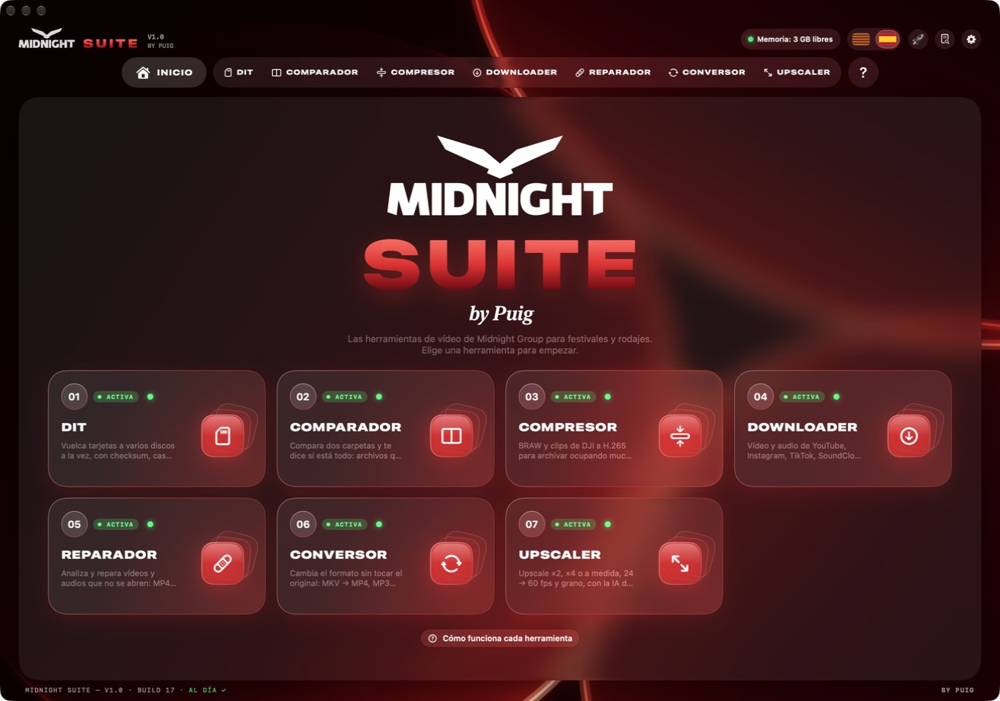

---

Midnight Suite reúne en una sola app todo lo que hace falta en un rodaje o en un festival: **volcar tarjetas con seguridad**, comprobar copias, comprimir y convertir archivos, descargar vídeos, reparar clips que no se abren, mejorar la resolución con la IA de Apple y **hacer subtítulos para Final Cut**.

Todo se hace **en tu Mac**: no se sube nada a internet y **el archivo original nunca se toca**.

## Novedades de la versión 2.1

- **DIT que comprueba cada clip**: antes de decir «Ya puedes borrarla» se comprueba que cada clip se abre de verdad, y el PDF lleva una miniatura de cada clip.
- **DIT más claro**: dos copias en el mismo disco ya no cuentan como dos; un disco que no se puede leer sale como «ilegible» y no como «diferente»; parar la copia pide confirmación; «Se copia en:» muestra la ruta real y el progreso sale en el icono del Dock.
- **Para el rodaje**: nota por tarjeta, carpetas automáticas por día, cámara y rollo, sesión de rodaje («FIB 2026 · Día 3»), proxies al terminar e informe guardado en el disco de destino.
- **¿Listo para el festival?**: una comprobación de un clic antes de salir.
- **Avisos**: adiós a Telegram; el correo lleva el nombre del Mac, avisa si falla y también llega al terminar una herramienta larga. Notificaciones con «Abrir el informe» y «Mostrar en el Finder», una por tarjeta.
- **Actualizaciones más seguras**: si una versión nueva no arranca, la app vuelve sola a la anterior; ffmpeg, yt-dlp y Gyroflow se comprueban cada vez.
- **Compresor**: BRAW en la GPU (más de 2× más rápido) con Extended Video, Highlight Recovery y espacio de color, y LUT .cube para material log.
- **Conversor**: normalizar el volumen (redes o TV), recortar inicio y final y copia de revisión con timecode y marca.
- **Upscaler y Estabilizador**: prueba de 5 segundos «Antes / Después» antes de hacerlo todo; el Estabilizador guarda también el proyecto de Gyroflow.
- **Subtítulos**: nombres del proyecto, buscar y reemplazar, importar SRT y traducción al inglés. **Reparador**: carpetas enteras. **Downloader**: solo un trozo.
- **Historial** con «¿Dónde está este clip?», «Enviar a…» en cada archivo terminado, recetas guardadas por herramienta y archivos soltados en el icono del Dock.
- **Interfaz más coherente**: mismos botones e iconos en todas las herramientas, carpeta de salida siempre visible, barra lateral más corta y animaciones nuevas.
- Más de 15 errores arreglados y la app va más fluida.

## Novedades de la versión 2.0

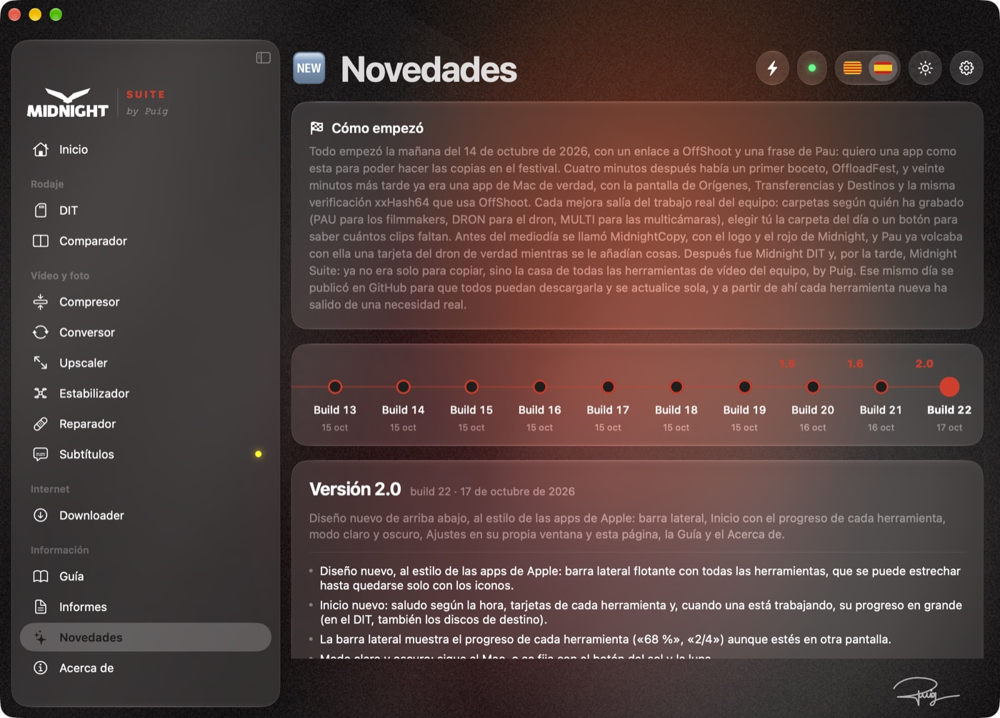

- **Diseño nuevo**, al estilo de las apps de Apple: barra lateral flotante con todas las herramientas, que se puede estrechar hasta quedarse solo con los iconos.
- **Inicio nuevo**: saludo según la hora, tarjetas de cada herramienta y, cuando una está trabajando, su progreso en grande (en el DIT, también los discos de destino).
- La barra lateral muestra el **progreso de cada herramienta** («68 %», «2/4») aunque estés en otra pantalla.
- **Modo claro y oscuro**: sigue al Mac, o se fija con el botón del sol y la luna.
- **Ajustes en su propia ventana** (⌘,): General, Apariencia, Avisos, Permisos, Complementos, Tu Mac y Actualizaciones.
- **Nuevas páginas**: Guía de cada herramienta, Novedades de todas las versiones y Acerca de.
- **Modo boost** (⚡): quita animaciones y cristal para ir más ligero; también respeta «Reducir movimiento» del Mac.
- **DIT más seguro**: con dos discos o más, «Ya puedes borrarla» solo aparece cuando hay dos copias verificadas, y cada tarjeta se reconoce por su identificador (dos tarjetas con el mismo nombre ya no se confunden).
- **Copias que no mienten**: si un disco da error al guardar, se desconecta o deja de responder, la copia sale como fallida; las copias cortadas se reanudan solas sin tocar nunca archivos que no haya hecho la app.
- **ASC MHL según el estándar** y activado por defecto; el PDF incluye todos los destinos, la hora completa, las velocidades y todos los errores.
- **Más rápido en Apple Silicon**: el Conversor y el Downloader usan el chip de vídeo del Mac, y las descargas bajan en 4 partes a la vez.
- El **Estabilizador** (ProRes) y el **Upscaler** conservan el timecode, y el Conversor avisa si un vídeo de 10 bits pasará a 8 bits.
- **Atajos** ⌘0–⌘9 para cada herramienta, botón ↻ para reintentar, el mismo aviso al terminar cualquier herramienta y una pantalla «Antes de empezar» la primera vez.
- **Instalador nuevo** con el diseño 2.0 y la historia de la app desde la build 1 en Novedades.

## Índice

- [Novedades de la versión 2.1](#novedades-de-la-versión-21)
- [Novedades de la versión 2.0](#novedades-de-la-versión-20)
- [Instalación](#instalación)
- [DIT · copias de tarjetas](#dit--copias-de-tarjetas)
- [Comparador](#comparador)
- [Compresor](#compresor)
- [Conversor](#conversor)
- [Upscaler](#upscaler)
- [Subtítulos](#subtítulos)
- [Reparador](#reparador)
- [Estabilizador](#estabilizador)
- [Downloader](#downloader)
- [Informes y actividad](#informes-y-actividad)
- [Permisos, complementos y requisitos](#permisos-complementos-y-requisitos)
- [Actualizaciones y seguridad](#actualizaciones-y-seguridad)
- [Preguntas frecuentes](#preguntas-frecuentes)

---

## Instalación

1. Descarga **[Midnight-Suite.dmg](https://github.com/paupuig92/midnight-suite/releases/latest/download/Midnight-Suite.dmg)**.
2. Ábrelo y arrastra **Midnight Suite** a la carpeta **Aplicaciones**.
3. La primera vez, el Mac avisa de que no puede verificar la app. **No pulses «Trasladar a la papelera»**: cierra el aviso y luego:
   - **macOS 15 o posterior**: abre **Ajustes del Sistema › Privacidad y seguridad**, baja hasta el final y pulsa **Abrir igualmente** (te pedirá confirmarlo con tu contraseña o Touch ID).
   - **macOS 14**: en Aplicaciones, **clic derecho** sobre Midnight Suite › **Abrir** › **Abrir**.
4. Listo. A partir de aquí la app **se actualiza sola**: cuando hay una versión nueva aparece un aviso arriba y se instala con un clic.

> La app está en **catalán y castellano**: se cambia con las banderas de arriba a la derecha.

¿Primera vez? La **Guía** de la barra lateral (o el botón **?** abajo a la derecha de cada herramienta) explica cada herramienta en 3 pasos sencillos (y, si quieres, los detalles técnicos).

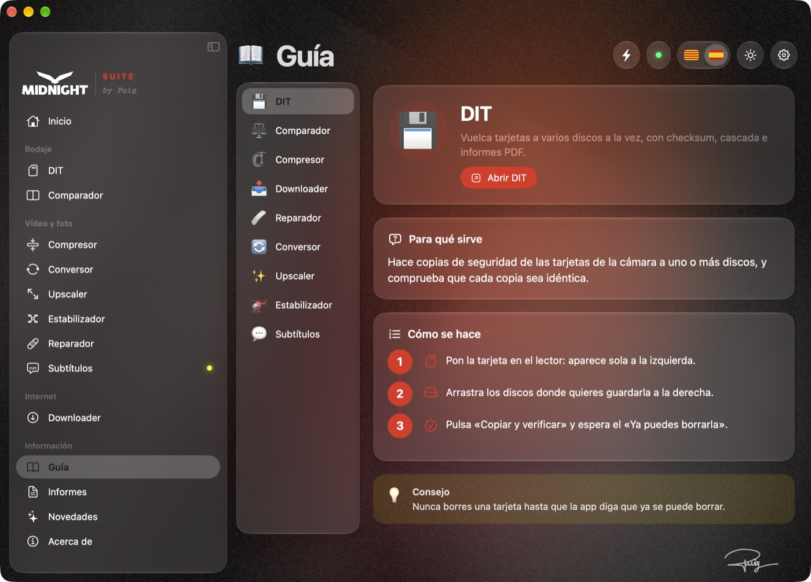

---

## DIT · copias de tarjetas

Hace copias de seguridad de las tarjetas de la cámara a **uno o varios discos a la vez** y comprueba que cada copia sea idéntica al original.

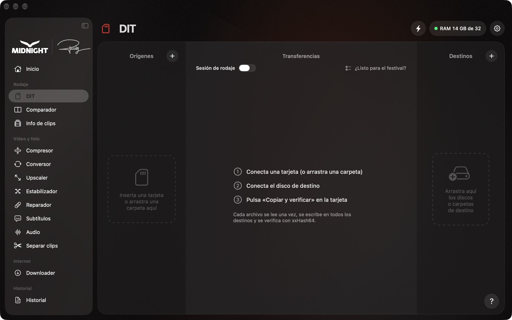

**Cómo se usa**

1. Pon la tarjeta en el lector: aparece sola en la columna de la izquierda.
2. Arrastra los discos (o la carpeta del día) a la columna de la derecha.
3. Pulsa **Copiar y verificar** y espera el aviso verde **«YA PUEDES BORRARLA»**.

**Lo que hace por dentro**

- La tarjeta se lee **una sola vez** y se escribe en todos los discos a la vez. Mientras copia un archivo, ya verifica el anterior y lee el siguiente.
- Cada archivo se verifica con **checksum xxHash64** (y **MD5** opcional). Opcionalmente genera un **ASC MHL**, el estándar de la industria.
- Nunca sobrescribe nada: si un clip ya está igual, se salta; si hay uno distinto con el mismo nombre, avisa.
- Si algo no se ha podido copiar o leer (un archivo que cambia de tamaño mientras se copia, un enlace simbólico, una ruta demasiado larga), lo dice y la tarjeta **no** se da por buena.
- **Copia en cascada**: primero al disco rápido y, desde él, al resto, para liberar la tarjeta antes.
- Ordena los clips en carpetas automáticamente según la cámara (`PAU`, `DRON`, `MULTI`…).
- Avisa si un lector, un cable o un disco va mucho más lento que otros días (señal de que algo empieza a fallar).
- Cada copia genera un **informe PDF** con la lista de archivos y sus checksums.

> **Nunca borres una tarjeta** hasta que la app diga «YA PUEDES BORRARLA».

---

## Comparador

Mira si dos carpetas tienen **exactamente los mismos archivos**. Sirve para saber si una copia está completa.

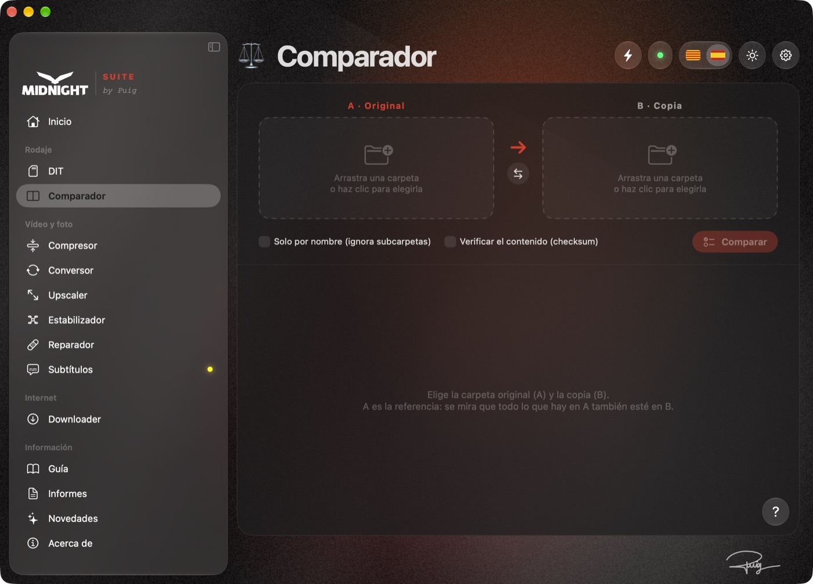

1. **A**: la carpeta original (por ejemplo, la tarjeta).
2. **B**: la copia que quieres comprobar.
3. Pulsa **Comparar**. En rojo, lo que falta; en naranja, lo que tiene un tamaño distinto; en verde, lo que está bien.

- **Solo por nombre**: ignora las subcarpetas (útil si en la copia los clips están repartidos en `PAU`, `DRON`…).
- **Verificar el contenido**: lee los dos lados y compara el checksum. Es más lento, pero detecta archivos corruptos aunque tengan el mismo tamaño.

---

## Compresor

Hace que los vídeos y las fotos **ocupen mucho menos sin que se note la diferencia**. Antes de empezar ya ves cuánto ocupará cada archivo y cuánto tardará.

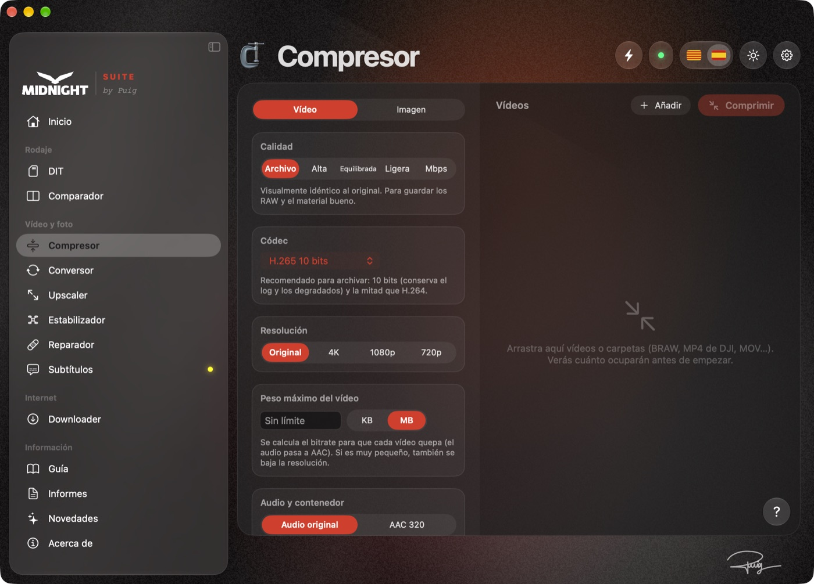

**Vídeo**

- Pensado para **archivar BRAW y clips de DJI en H.265 10 bits** ocupando mucho menos.
- Calidad: *Archivo* (visualmente idéntico), *Alta*, *Equilibrada*, *Ligera* o un bitrate a medida.
- **Peso máximo**: escribe, por ejemplo, «25 MB» y la app calcula el bitrate para que cada vídeo quepa (ideal para webs). Si es muy pequeño, también baja la resolución.
- **BRAW** sin necesidad de plugins de pago: usa el motor oficial de Blackmagic de **DaVinci Resolve** o **Blackmagic RAW Player** (gratuitos). Puede guardarlo en *Log* para etalonar o convertirlo a *Rec.709*.
- Conserva timecode, metadatos y fechas del original, y **todas las pistas de audio** (también el audio multicanal de cámaras como la FX6 o un 5.1).

**Imagen** (al estilo de compressor.io)

- JPG, HEIC, AVIF, WebP o PNG, con o sin pérdida.
- **Peso máximo en KB o MB**: busca la mejor calidad que quepa y, si hace falta, reduce los píxeles.
- Comparación **antes / después** deslizando una línea.

---

## Conversor

Cambia el **tipo de archivo**: de MKV a MP4, de MP3 a WAV, de vídeo a GIF, de HEIC a JPG…

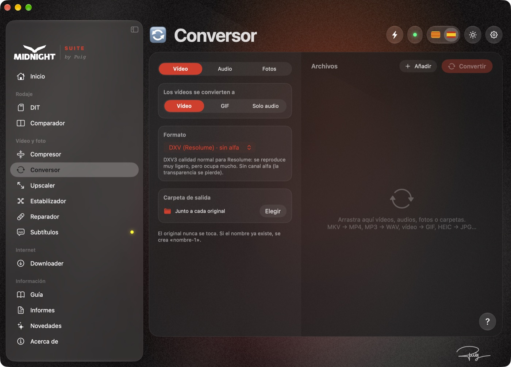

- **«Sin recodificar»** (en verde): el vídeo de dentro ya es compatible, así que solo se cambia el «envoltorio». Tarda segundos y **no pierde nada de calidad**.
- **«Recodificando»** (en naranja): se convierte con la máxima calidad usando el chip del Mac.
- **Vídeo**: MP4 (H.264 o HEVC), MOV, ProRes 422 / HQ / Proxy, MKV, WEBM y **DXV** para Resolume (calidad normal, sin alfa).
- **GIF**: eliges el ancho, los fps y un **peso máximo en MB** (lo reintenta hasta que quepa).
- **Audio**: WAV, AIFF, FLAC, MP3, AAC y OGG, o sacar solo el audio de un vídeo.
- **Fotos**: JPG, PNG, HEIC, TIFF y WEBP, conservando el EXIF.

---

## Upscaler

Hace **más grandes y más nítidos** los vídeos y las fotos con la **inteligencia artificial de Apple** (macOS 26 o posterior).

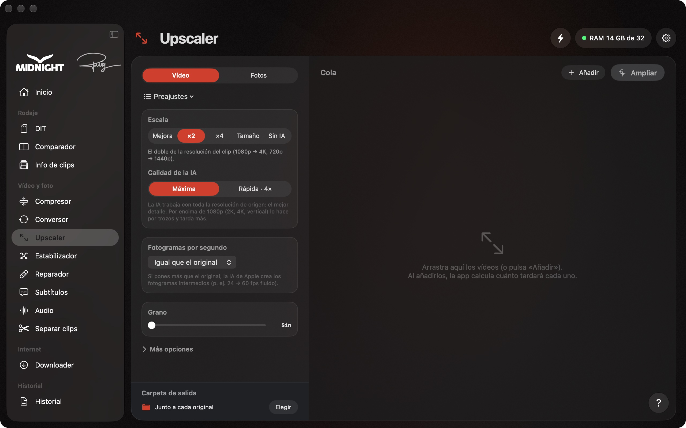

- **Vídeo**: ×2, ×4, a medida o *mejorar a la misma resolución* (ideal para vídeos hechos con IA que se ven blandos en pantallas grandes). También puede pasar de 24 a 60 fps y añadir grano de película.
- **Fotos**: ×2, ×4 o a medida, con comparación antes / después. Las fotos grandes se procesan por trozos y los PNG **mantienen la transparencia**.
- Los vídeos con **transparencia** (ProRes 4444 o HEVC con alfa) la mantienen: la app elige sola un formato que la conserve.
- Antes de empezar, la app calcula **cuánto tardará** cada vídeo.

---

## Subtítulos

Hace los **subtítulos automáticamente** y los pone en **Final Cut** como títulos que puedes editar. También saca **SRT** y **TXT** para Premiere, DaVinci, CapCut o YouTube.

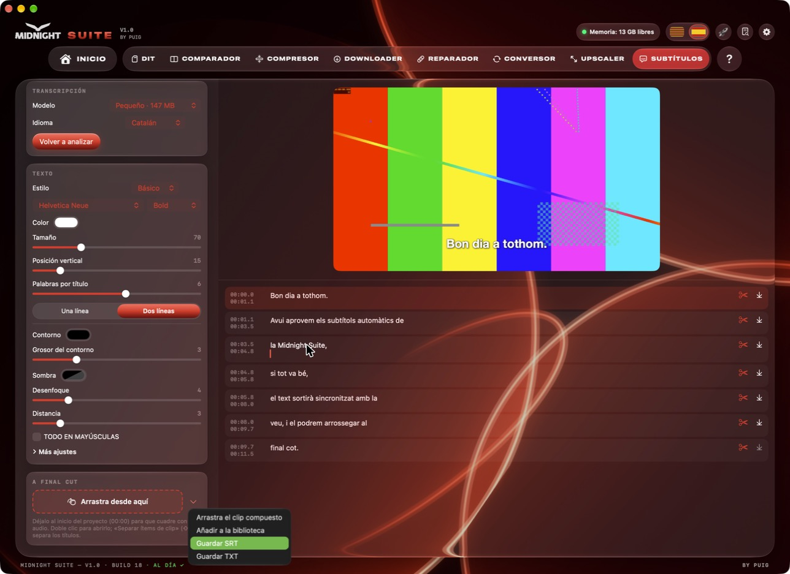

1. Arrastra el **proyecto** desde el navegador de Final Cut (o cualquier vídeo o audio), de **1 hora como máximo**. Si es más largo, haz los subtítulos por partes.
2. Elige el idioma (**catalán, castellano o inglés**) y pulsa **Analizar el audio**.
3. Corrige el texto a la derecha: puedes **partir** (tijeras) o **juntar** subtítulos.
4. Llévalo a Final Cut:
   - **Arrastra el clip compuesto** al inicio de la línea de tiempo (00:00). Doble clic para abrirlo; **⇧⌘G** separa los títulos.
   - **Añadir a la biblioteca**: crea una copia del proyecto con los subtítulos ya puestos.

**Lo que hace por dentro**

- Transcribe con **Whisper** (whisper.cpp) en tu Mac, con la GPU. No se sube nada.
- Un **detector de voz** salta música y silencios para que no se invente texto.
- Modelos: **Pequeño** (150 MB), **Mediano** (490 MB) y **Grande** (1,6 GB, el más preciso). Se descargan la primera vez y se comprueba que estén enteros.
- Reconstruye el audio del montaje a partir del proyecto de Final Cut, con compuestos y audio conectado. Los clips con cambio de velocidad o multicámara se avisan.
- Títulos **Basic Title** de serie, con tipografía, tamaño, color, contorno, sombra, posición, mayúsculas y resaltado de la palabra que se dice.

---

## Reparador

Intenta arreglar vídeos y audios que **no se abren**, por ejemplo cuando la cámara se apagó mientras grababa.

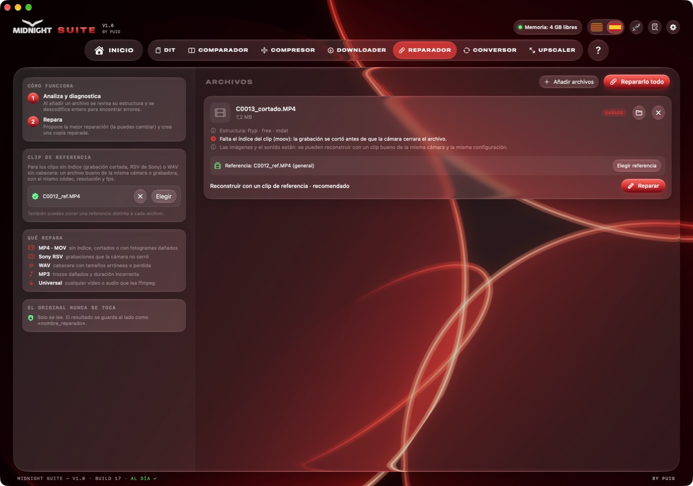

1. Arrastra el archivo: la app lo **analiza** y explica qué le pasa y si se puede salvar.
2. Si puedes, añade un **clip bueno de la misma cámara** como referencia.
3. Pulsa **Reparar**: se crea una copia reparada (`nombre_reparado`). El original no se toca.

Repara **MP4 / MOV** sin índice o cortados, **RSV de Sony**, **WAV** con la cabecera dañada, **MP3** y, en general, cualquier vídeo o audio que se pueda leer.

---

## Estabilizador

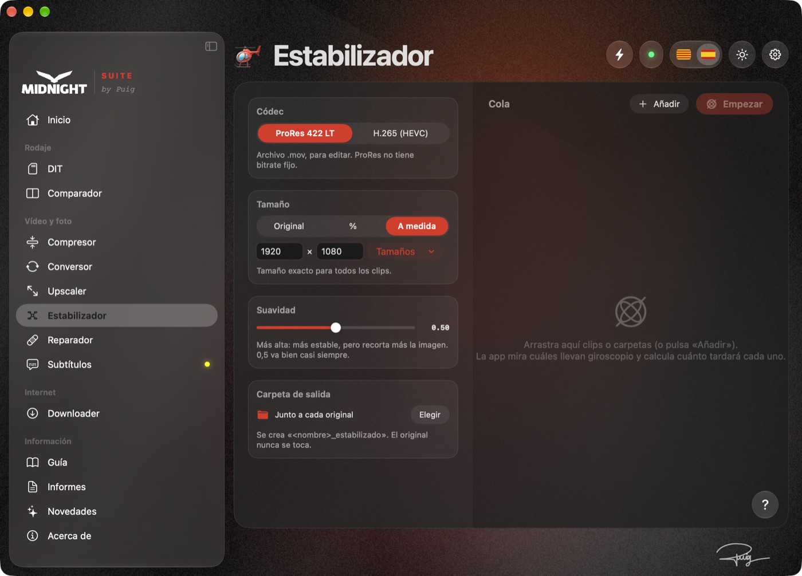

Estabiliza clips de **drones, GoPro y cámaras de acción** con los datos del giroscopio que guarda la cámara, con **Gyroflow**.

1. La primera vez, instala Gyroflow desde la propia app (se descarga de su web oficial y se comprueba).
2. Arrastra los clips: la app mira si llevan datos del giroscopio.
3. Elige el formato (ProRes 422 LT o H.265) y pulsa **Empezar**: se crea una copia (`nombre_estabilizado`). El original no se toca.

---

## Downloader

Descarga vídeo o música de **YouTube, Instagram, TikTok, SoundCloud, Spotify, Vimeo** y más de 1.800 webs.

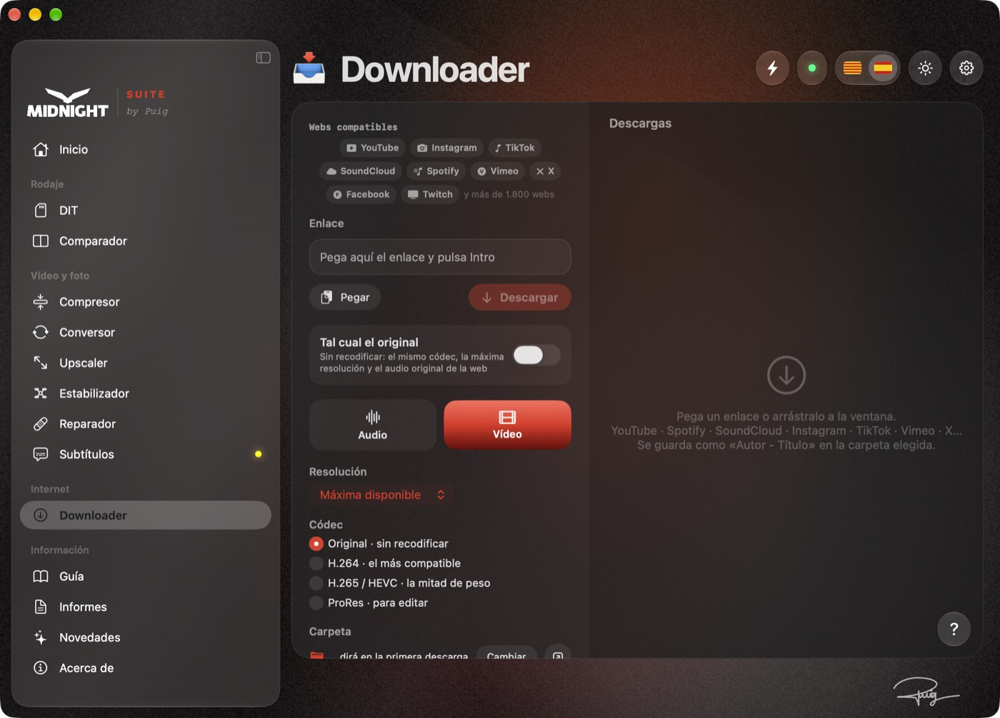

1. Copia el enlace y pégalo en la caja.
2. Elige **vídeo** o **solo audio**, tal cual el original o convertido.
3. Pulsa **Descargar**. La primera vez te pregunta en qué carpeta guardar: la app solo tendrá acceso a esa carpeta.

Para Instagram o vídeos que piden iniciar sesión, elige el navegador en **Sesión del navegador** y pulsa **Probar la sesión** para comprobar que funciona.

---

## Informes y actividad

Todo lo que se hace con la app **queda registrado**: qué, con qué archivos, cómo ha terminado y, si ha fallado, **por qué**.

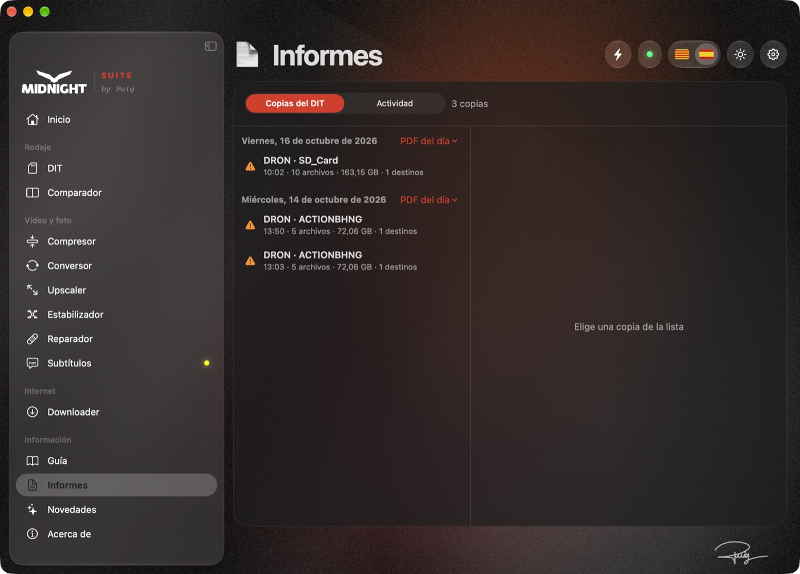

- **Copias del DIT**: el historial de todas las copias, con su informe PDF.
- **Actividad**: todas las herramientas. Se puede filtrar por herramienta o ver **solo los errores**, buscar por nombre de archivo y exportar a PDF.
- **Copiar el detalle**: para enviar un error a quien te ayude.
- Se guarda un año de historial.

---

## Permisos, complementos y requisitos

En **Ajustes** (⚙︎ o ⌘,), las pestañas **Permisos**, **Complementos** y **Tu Mac** muestran todo lo que necesita la app y lo que falta.

- **Permisos**: notificaciones, discos y carpetas, Mail… con un botón que abre directamente el apartado de Ajustes del Sistema.
- **Complementos** que se descargan solos de sus webs oficiales (ffmpeg, yt-dlp, deno): instalar, reinstalar o borrar.
- **Programas externos** (DaVinci Resolve, Blackmagic RAW Player, BRAW Toolbox y Gyroflow): descargar, actualizar o eliminar desde aquí.
- **Tu Mac**: los requisitos de cada herramienta comparados con tu Mac. Si a una herramienta le falta algo, en la barra lateral sale un punto amarillo o rojo a su lado.

| Herramienta | RAM mínima | Recomendada | Otros |
|---|---|---|---|
| DIT · Comparador · Downloader · Conversor | 4 GB | 8 GB | — |
| Compresor · Reparador | 8 GB | 16 GB | ffmpeg (se instala solo) · DaVinci Resolve para BRAW |
| Upscaler | 8 GB | 16 GB | macOS 26 · chip M3 o Pro/Max/Ultra recomendado |
| Subtítulos | 8 GB | 16 GB | ffmpeg · modelo de Whisper (se descarga solo) |

**Modo boost ⚡**: el botón del rayo quita las animaciones y el efecto cristal para que la app vaya más ligera (portátiles con batería o que se calientan).

---

## Actualizaciones y seguridad

- Las actualizaciones se descargan de este repositorio y van **firmadas digitalmente**: la app **no instala ninguna actualización que no esté firmada** por Midnight Group. La firma cubre también el número de versión, así que nadie puede hacer volver la app a una versión antigua.
- La lista de modelos de los Subtítulos también va firmada: la app no descarga ningún modelo que no esté en la lista firmada.
- La app está firmada siempre con el mismo certificado, así que macOS **recuerda los permisos** entre actualizaciones.
- Las herramientas pesadas (Upscaler, Compresor, Reparador) trabajan en un **proceso aparte**: si algo falla, la app y las copias del DIT siguen funcionando.
- Mientras el DIT copia, el resto de herramientas pasan a **segundo plano** para no frenar la copia.

**¿Por qué fiarse?** Midnight Suite solo instala actualizaciones que llevan una firma criptográfica (Ed25519) hecha con una clave que solo tiene Puig: ni GitHub ni nadie con acceso al repositorio puede hacer que la app se actualice con una versión que él no haya firmado. La firma cubre el archivo entero, el número de versión (no se puede volver atrás) y el texto del aviso. La app comprueba el archivo antes de tocar nada, se sustituye de una vez y, si algo falla, deja la versión anterior tal como estaba. Los complementos (ffmpeg, yt-dlp, deno, Gyroflow y los modelos de Whisper) se descargan solo por HTTPS de sus fuentes oficiales y se comprueban: ffmpeg, yt-dlp y deno con su checksum SHA-256, los modelos con el SHA-256 de una lista firmada y Gyroflow con la firma de código de su propio equipo. Lo que todavía no tiene es la notarización de Apple; por eso macOS avisa la primera vez: instálala solo desde el enlace de esta página o el que te pase Puig.

---

## Preguntas frecuentes

**¿Se sube algo a internet?**
No. Todo se procesa en tu Mac. Solo se conecta para buscar actualizaciones, descargar los complementos y, en el Downloader, para descargar lo que le pidas.

**¿Puede estropear mis archivos originales?**
No. Ninguna herramienta modifica el original: siempre se crea un archivo nuevo al lado (o en la carpeta que elijas).

**El Mac dice que no puede verificar la app.**
Es normal: la app es interna de Midnight y no pasa por la notarización de Apple (hace falta una cuenta de desarrollador de pago). En macOS 15 o posterior: Ajustes del Sistema › Privacidad y seguridad, baja hasta el final y pulsa **Abrir igualmente**. En macOS 14: clic derecho sobre la app › **Abrir**. No pulses «Trasladar a la papelera». Solo hace falta la primera vez: las actualizaciones las instala la propia app y no vuelve a salir.

**Algo ha fallado, ¿cómo pido ayuda?**
Abre **Informes › Actividad**, elige lo que ha fallado y pulsa **Copiar el detalle**. También tienes **Copiar el registro (para soporte)** en **Ajustes › Actualizaciones** y en **Acerca de**.

---

**Midnight Suite** · © Midnight Group · by Puig

