

# Midnight Suite

**Las herramientas de vídeo de Midnight Group para festivales y rodajes · by Puig**

### [⬇︎ Descargar para Mac](https://github.com/paupuig92/midnight-suite/releases/latest/download/Midnight-Suite.dmg)

Mac con chip Apple (M1 o posterior) · macOS 14 o posterior · se actualiza sola

[Instalación](#instalación) · [Requisitos](#requisitos) · [Herramientas](#herramientas) · [Seguridad](#seguridad) · [Ayuda](#ayuda) · [Novedades](#novedades)

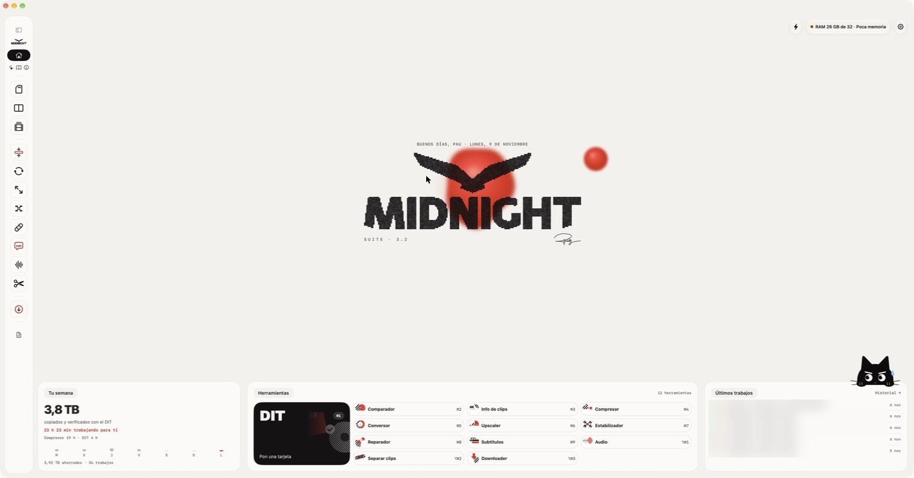

Una app para Mac que junta todo lo que hace falta en un rodaje o en un festival: copiar tarjetas sin riesgo, comprimir, convertir, estabilizar, subtitular y mucho más. No hace falta saber de códecs ni usar la terminal: arrastras el archivo, pulsas un botón y listo.

| 🔒 Todo pasa en tu Mac | 🛡️ El original no se toca | 🔄 Se actualiza sola |
|---|---|---|
| Tus vídeos no se suben a internet. | Cada herramienta crea un archivo nuevo. | Sale un aviso y se instala con un clic. |

## Instalación

Unos 5 minutos, y solo una vez.

1. **Comprueba tu Mac.** Menú Apple › **Acerca de este Mac**: tiene que poner chip Apple (M1, M2, M3…) y macOS 14 o posterior.
2. **Descarga** [Midnight-Suite.dmg](https://github.com/paupuig92/midnight-suite/releases/latest/download/Midnight-Suite.dmg). El enlace siempre baja la última versión.
3. **Haz doble clic en el .dmg** y arrastra el icono de Midnight Suite a la carpeta **Aplicaciones**. Después, expulsa el disco ⏏︎.
4. **Ábrela desde Aplicaciones.** La primera vez, el Mac avisa de que no puede comprobar la app. Es normal ([por qué](#seguridad)) y solo pasa una vez:
   - **macOS 15 o posterior:** ve a **Ajustes del Sistema › Privacidad y seguridad**, baja hasta el final, pulsa **Abrir igualmente** y confirma. Vuelve a abrir la app.
   - **macOS 14:** en Aplicaciones, clic derecho sobre la app › **Abrir** › **Abrir**.
5. **«Antes de empezar».** Pulsa **Activar los avisos** e **Instalar lo que falta**. La primera vez que copies una tarjeta, pulsa **Permitir** o el DIT no podrá leerla.

> [!WARNING]
> **No pulses «Trasladar a la papelera»** en el aviso del paso 4. Ciérralo con el otro botón.

> [!TIP]
> Los complementos incluyen el modelo de los Subtítulos (unos 1,6 GB) y Gyroflow (unos 90 MB). Mejor instalarlos con buena conexión, antes de salir de la oficina.

<b>Si algo no va bien</b>

- **No aparece «Abrir igualmente».** Intenta abrir la app, cierra el aviso y, justo después, ve a Privacidad y seguridad. En macOS 15 o posterior, el clic derecho › Abrir ya no sirve.
- **He pulsado «Trasladar a la papelera».** No pasa nada: vuelve a descargar el .dmg y repite desde el paso 3.
- **Pide moverla a Aplicaciones.** Pulsa **Moverla a Aplicaciones**, o ciérrala y arrástrala tú (si pregunta, **Reemplazar**). Las actualizaciones solo se instalan si la app está ahí.
- **Una herramienta tiene un punto amarillo o rojo.** Le falta un complemento, un permiso o memoria. Haz clic en el punto y se abre el Ajuste que lo arregla.
- **Gyroflow de la App Store.** No sirve: instálalo desde el propio Estabilizador.

## Requisitos

| | |
|---|---|
| **Mac** | Solo chip Apple (M1 o posterior). Intel no es compatible. |
| **Sistema** | macOS 14 o posterior. El **Upscaler** necesita **macOS 26**. |
| **Memoria** | Con 8 GB funcionan todas, una pesada cada vez. Con 16 GB o más, varias a la vez. |
| **Idioma** | Castellano y catalán (**Ajustes › General › Idioma**). |

<b>Qué pide cada herramienta</b>

| Herramienta | RAM mínima | Para varias a la vez | Además necesita |
|---|---|---|---|
| DIT · Comparador | 4 GB | 8 GB | — |
| Conversor | 4 GB | 8 GB | ffmpeg |
| Downloader | 4 GB | 8 GB | yt-dlp, deno y ffmpeg |
| Compresor | 8 GB | 16 GB | ffmpeg recomendado · DaVinci Resolve (gratuito) para BRAW · 50 GB libres recomendados |
| Reparador | 8 GB | 16 GB | ffmpeg (se instala solo) |
| Estabilizador | 8 GB | 16 GB | Gyroflow · 50 GB libres recomendados |
| Upscaler | 8 GB | 16 GB | macOS 26 · M3 o un Pro/Max/Ultra recomendado · 50 GB libres recomendados |
| Subtítulos | 8 GB | 16 GB | ffmpeg · modelo de Whisper · 3 GB libres para los modelos |

**Semáforo de memoria:** 🟢 todo normal · 🟡 una sola herramienta cada vez · 🔴 no empieza ninguna (cierra otras apps).
**Modo boost ⚡:** da toda la potencia a una sola herramienta; las demás esperan en la cola.
**Interfaz ligera:** en **Ajustes › Apariencia**, sin cristal ni animaciones, para gastar menos batería.

## Herramientas

> [!CAUTION]
> **Nunca borres una tarjeta** hasta que el DIT diga **«Ya puedes borrarla»**.

<table>
<tr>
<td width="50%" valign="top">
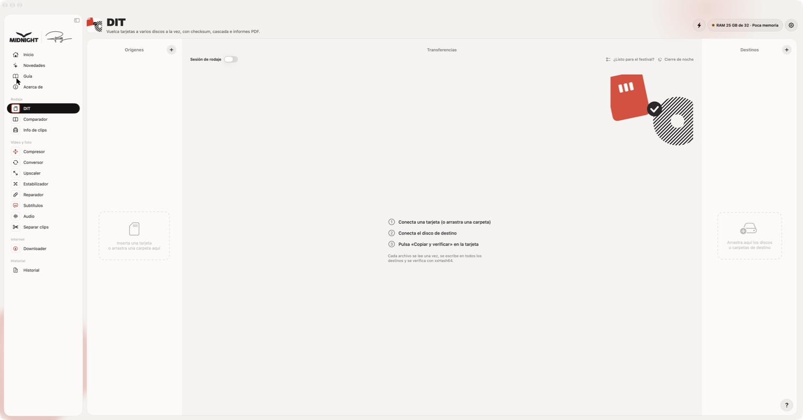 
<b>💾 DIT</b> 
Copia las tarjetas a uno o varios discos y comprueba que cada copia es idéntica.

<b>Cómo se usa</b>

1. Pon la tarjeta en el lector. Aparece sola a la izquierda.
2. Arrastra a la derecha los discos donde quieres guardarla.
3. Pulsa **Copiar y verificar** y espera el aviso verde **«Ya puedes borrarla»**.

</td>
<td width="50%" valign="top">
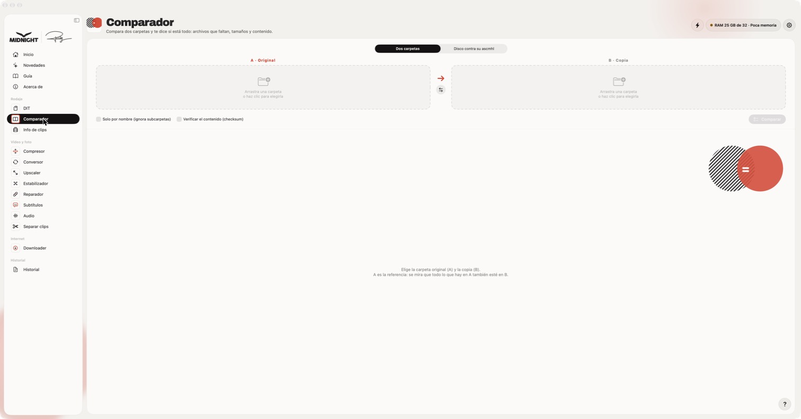 
<b>🔍 Comparador</b> 
Dice si dos carpetas tienen exactamente los mismos archivos.

<b>Cómo se usa</b>

1. **A**: la carpeta original (por ejemplo, la tarjeta).
2. **B**: la copia que quieres comprobar.
3. Pulsa **Comparar**: rojo, falta o está mal; amarillo, tamaño distinto; verde, bien. El ✅ verde solo sale si marcas **Verificar el contenido (checksum)**.

</td>
</tr>
<tr>
<td width="50%" valign="top">
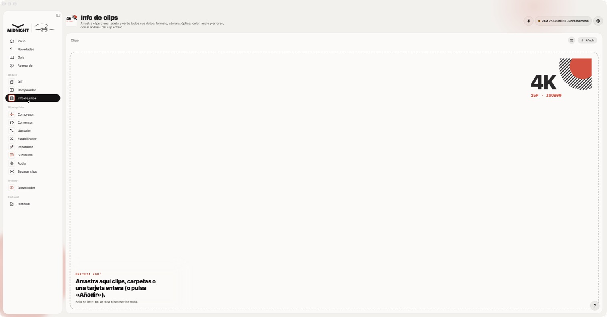 
<b>ℹ️ Info de clips</b> 
Muestra cámara, ISO, timecode y audio de cada clip, y avisa de lo que falla antes de editar.

<b>Cómo se usa</b>

1. Arrastra los clips o la carpeta de la tarjeta.
2. Mira la **tabla**: en amarillo, lo que no coincide con el resto.
3. Pulsa un clip para ver el detalle, o **Analizar entero**. Con **Exportar** sacas JSON, CSV o PDF.

</td>
<td width="50%" valign="top">
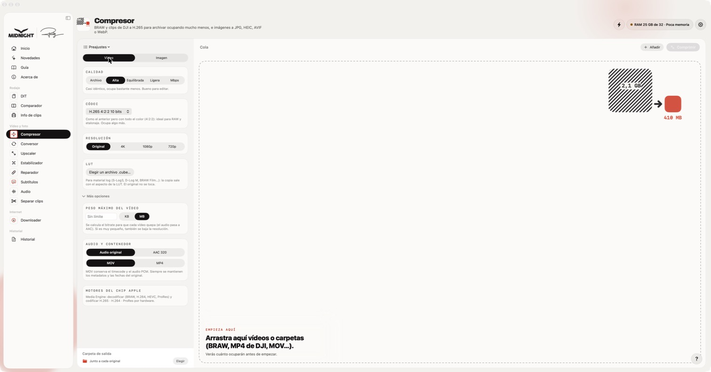 
<b>🗜️ Compresor</b> 
Vídeos y fotos que ocupan mucho menos sin que se note, también BRAW. 
BRAW necesita DaVinci Resolve o Blackmagic RAW Player (gratuitos).

<b>Cómo se usa</b>

1. Arrastra vídeos o fotos.
2. Elige la calidad o el peso máximo (por ejemplo, 500 KB para una web).
3. Pulsa **Comprimir**.

</td>
</tr>
<tr>
<td width="50%" valign="top">
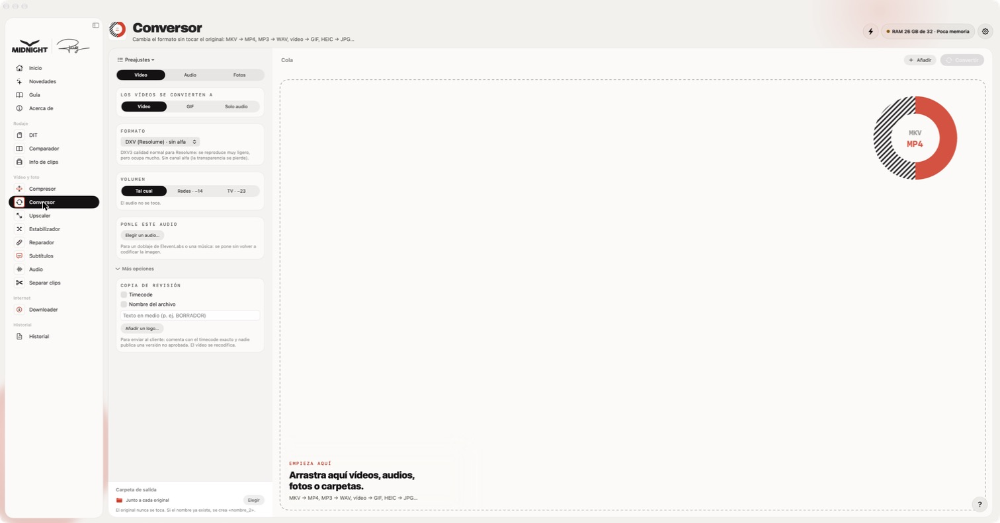 
<b>🔁 Conversor</b> 
Cambia el tipo de archivo: MKV a MP4, vídeo a GIF, HEIC a JPG…

<b>Cómo se usa</b>

1. Arrastra los archivos.
2. Elige el formato (pestañas **Vídeo**, **Audio** o **Fotos**).
3. Pulsa **Convertir**. Si pone **«Sin recodificar»**, tarda segundos y no pierde calidad.

</td>
<td width="50%" valign="top">
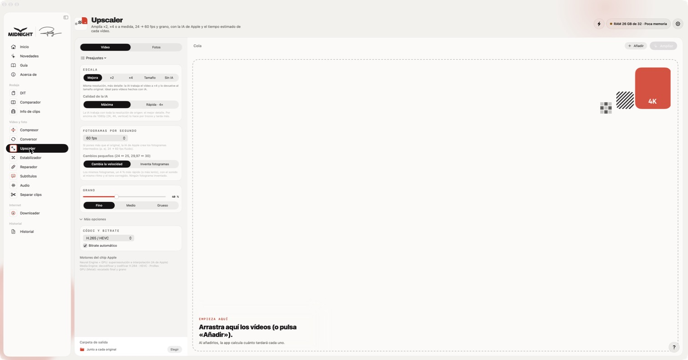 
<b>✨ Upscaler</b> 
Hace vídeos y fotos más grandes y nítidos con la IA de Apple. 
Necesita macOS 26.

<b>Cómo se usa</b>

1. Arrastra vídeos o fotos (pestaña **Vídeo** o **Fotos**).
2. Elige cuánto más grande: ×2, ×4 o un tamaño concreto.
3. Pulsa **Ampliar**. La app te dice antes cuánto tardará.

</td>
</tr>
<tr>
<td width="50%" valign="top">
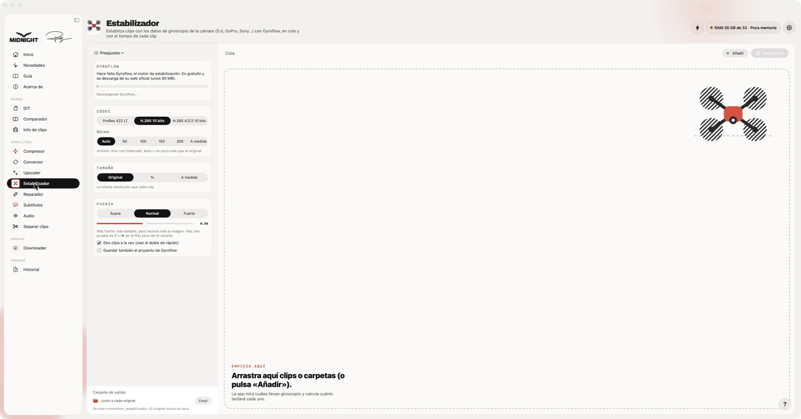 
<b>🚁 Estabilizador</b> 
Estabiliza clips de dron, GoPro y cámaras de acción con su giroscopio. 
Usa Gyroflow: se instala con un botón, unos 90 MB.

<b>Cómo se usa</b>

1. Arrastra clips o carpetas. La app mira cuáles llevan datos del giroscopio.
2. Elige el códec, el tamaño y la suavidad.
3. Pulsa **Estabilizar** y verás cuánto falta. Con **Dos clips a la vez** va casi el doble de rápido.

</td>
<td width="50%" valign="top">
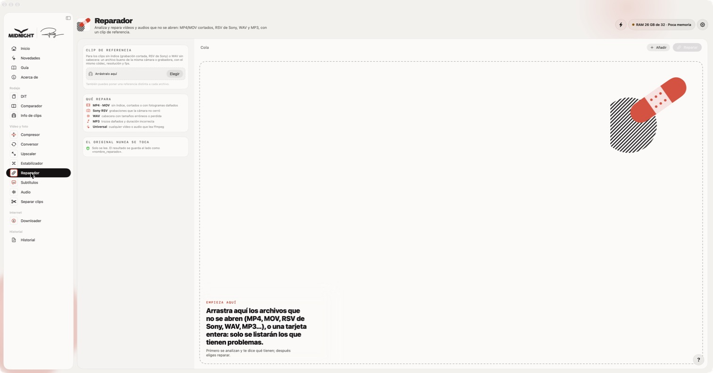 
<b>🩹 Reparador</b> 
Intenta arreglar vídeos y audios que no se abren, y te dice antes si se pueden salvar.

<b>Cómo se usa</b>

1. Arrastra el archivo (o una carpeta). La app te dice qué le pasa y si se puede salvar.
2. Si puedes, añade un **clip bueno de la misma cámara** como referencia.
3. Pulsa **Reparar**. Se crea una copia arreglada (`nombre_reparado`).

</td>
</tr>
<tr>
<td width="50%" valign="top">
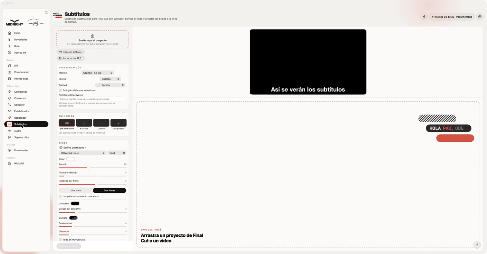 
<b>💬 Subtítulos</b> 
Subtítulos automáticos y editables para Final Cut, y SRT para el resto de programas.

<b>Cómo se usa</b>

1. Arrastra el **proyecto** desde Final Cut (o cualquier vídeo o audio).
2. Elige el idioma (**catalán, castellano o inglés**) y pulsa **Analizar el audio**. Corrige lo que haga falta.
3. Arrastra los subtítulos al inicio de la línea de tiempo (00:00), o pulsa **Añadir a la biblioteca**.

</td>
<td width="50%" valign="top">
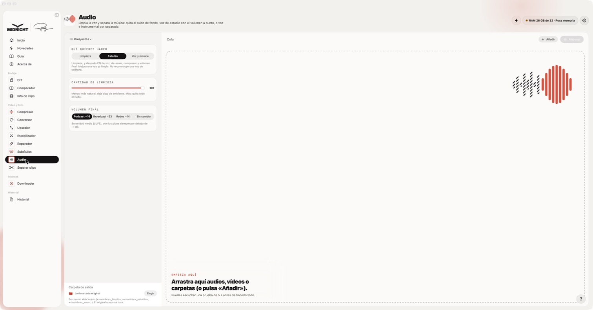 
<b>🎙️ Audio</b> 
Limpia una voz, la deja como de estudio o la separa de la música, sin internet.

<b>Cómo se usa</b>

1. Arrastra audios o vídeos (WAV, MP3, MP4, MOV…).
2. Elige **Limpieza de voz**, **Voz de estudio** o **Voz y música**.
3. Pulsa el botón. Con 🎧 escuchas 5 s de prueba antes y después.

</td>
</tr>
<tr>
<td width="50%" valign="top">
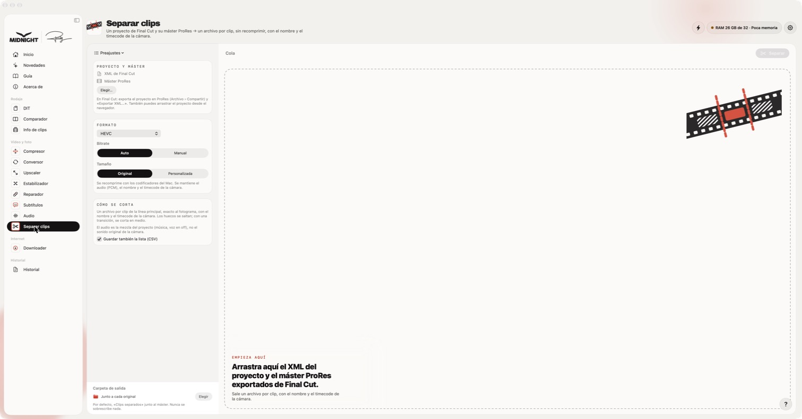 
<b>✂️ Separar clips</b> 
Corta el máster de Final Cut en un archivo por clip, con su nombre y su timecode.

<b>Cómo se usa</b>

1. En Final Cut, exporta el proyecto en **ProRes** y el **XML** (Archivo › Exportar XML…).
2. Arrastra el XML y el máster a la ventana.
3. Pulsa **Separar**. Los clips salen en «Clips separados», junto al máster.

</td>
<td width="50%" valign="top">
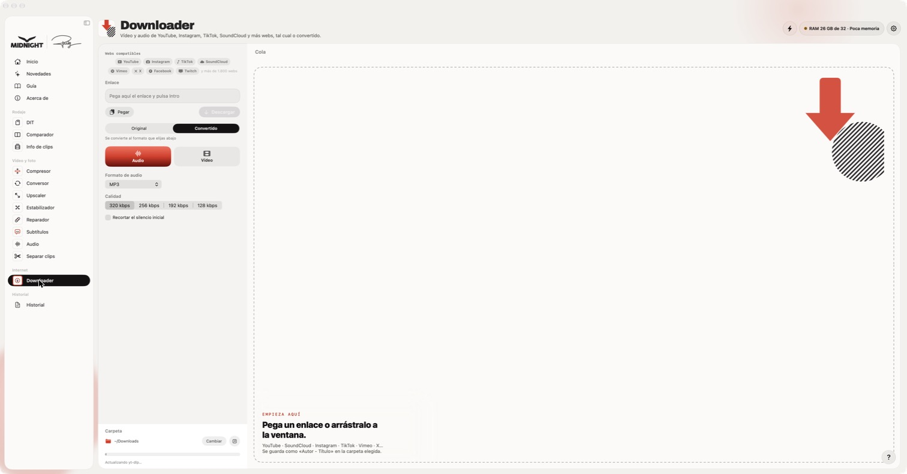 
<b>⬇️ Downloader</b> 
Descarga vídeo o música de YouTube, Instagram, TikTok, SoundCloud, Vimeo y más. 
Instagram y algunos vídeos piden iniciar sesión.

<b>Cómo se usa</b>

1. Pega el enlace en la caja.
2. Elige **vídeo** o **solo el audio** (entero o un trozo).
3. Pulsa **Descargar**. Para Instagram, ten tu cuenta abierta en Chrome o Safari: la app usa esa sesión sola (también puedes elegir el navegador en **Sesión del navegador**).

</td>
</tr>
</table>

<b>Lo esencial del DIT</b>

- La tarjeta se lee una sola vez y se escribe en todos los discos a la vez, con checksum xxHash64 (y MD5 si lo activas).
- Antes de dar la tarjeta por buena, comprueba que cada clip se abre de verdad.
- Con dos discos o más, «Ya puedes borrarla» solo sale cuando hay **dos copias verificadas**. Dos copias en el mismo disco cuentan como una.
- Nunca sobrescribe nada. Si algo no se ha podido copiar o leer, lo dice y la tarjeta **no** se da por buena.
- Si sacas un disco a media copia, avisa: «NO formatees la tarjeta».
- Copiar a un NAS por red (SMB) también es seguro: al terminar cada clip, comprueba que el NAS lo deja leer.
- Cada copia genera un informe PDF con los archivos, sus checksums y una miniatura de cada clip.

### Y además

<table>
<tr>
<td width="50%" valign="top">
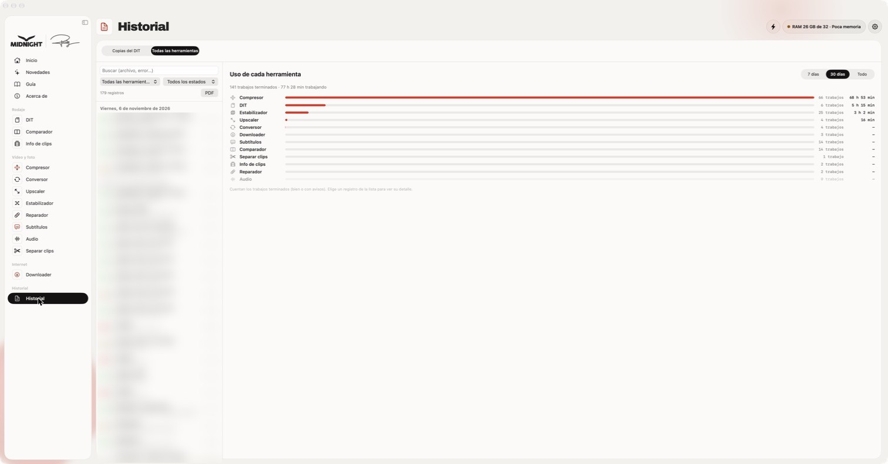 
<b>📋 Historial</b> 
Todo lo que ha hecho la app, con informes en PDF y «¿Dónde está este clip?».

<b>Cómo se usa</b>

**Copias del DIT** con su informe PDF · **Todas las herramientas**: trabajos y horas de cada una · **¿Dónde está este clip?** · **Copiar el detalle** para enviar un error.

</td>
<td width="50%" valign="top">

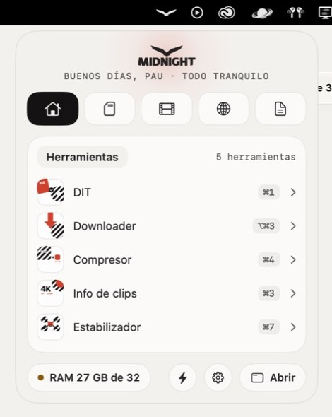

<b>🪽 Barra de menús</b> 
Los trabajos en curso, «Volcar» para tarjetas nuevas y acceso rápido a las herramientas.
</td>
</tr>
<tr>
<td width="50%" valign="top">
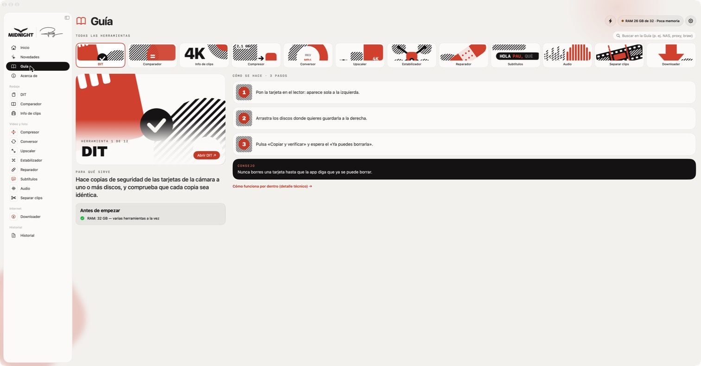 
<b>📖 Guía</b> 
Cada herramienta con sus pasos numerados y un buscador. Menú <b>Ayuda</b> (⌘?).
</td>
<td width="50%" valign="top">
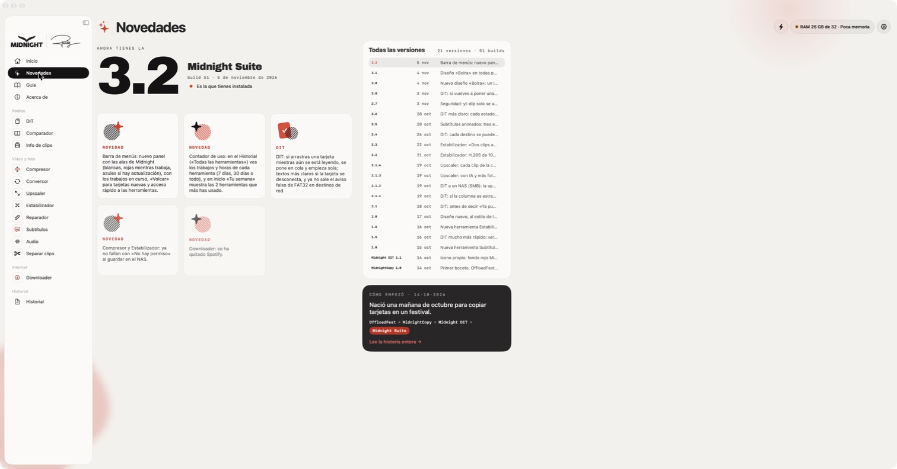 
<b>🆕 Novedades</b> 
La historia completa de la app, versión a versión.
</td>
</tr>
</table>

## Actualizaciones

No hace falta volver a esta página. Cuando hay una versión nueva, sale un aviso en la app: pulsa **Actualizar** y se cierra, se actualiza y se vuelve a abrir. También puedes buscarla en **Midnight Suite › Buscar actualizaciones…**

Si hay una copia del DIT o una herramienta trabajando, la app espera a que termine.

## Seguridad

El Mac avisa la primera vez porque la app **no está notarizada por Apple** (hace falta una cuenta de desarrollador de pago). Esto es lo que sí tiene:

- **Actualizaciones firmadas** (Ed25519). La app no instala nada que no esté firmado por Puig.
- **Vuelta atrás automática** si una versión nueva no arranca.
- **Complementos comprobados** antes de usarlos.
- **Herramientas pesadas en un proceso aparte:** si una falla, la app y las copias del DIT siguen funcionando.

Descarga la app **solo desde esta página** o desde el enlace que te pase Puig.

## Ayuda

**¿Se sube algo a internet?** Tus vídeos, no. La app se conecta para buscar actualizaciones, descargar complementos y, en el Downloader, bajar lo que le pidas.

**¿Algo ha fallado?** Abre **Historial › Actividad**, elige lo que ha fallado, pulsa **Copiar el detalle** y envíaselo a Puig. Si la app se cerró sola, al abrirla te propone crear un paquete de diagnóstico.

## Novedades

- **Diseño «Boira» en todas partes:** colores, letra y tarjetas iguales en todas las pantallas, con icono nuevo y una Guía renovada.
- **Barra de menús:** panel nuevo con las alas de Midnight y los trabajos en curso.
- **Contador de uso:** trabajos y horas de cada herramienta en el Historial.
- **Monitor del sistema:** temperatura, ventiladores, uso de cada núcleo y velocidad de los discos.

La historia completa está en la app: menú **Midnight Suite › Novedades**.

---

**Midnight Suite** · © Midnight Group · by Puig

